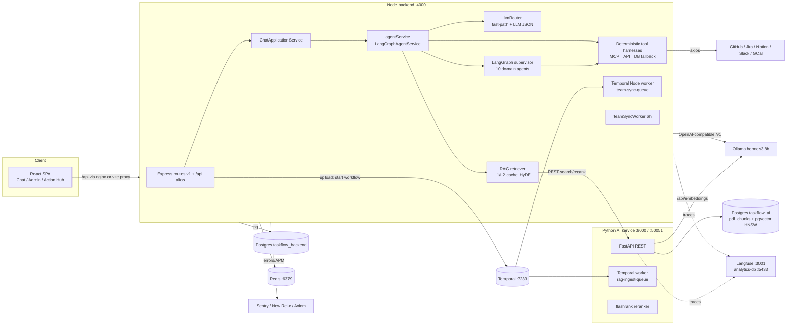
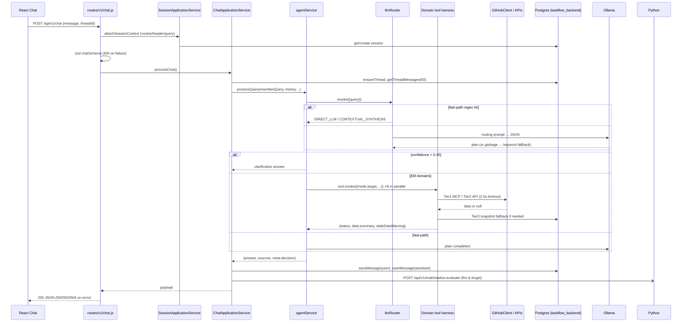
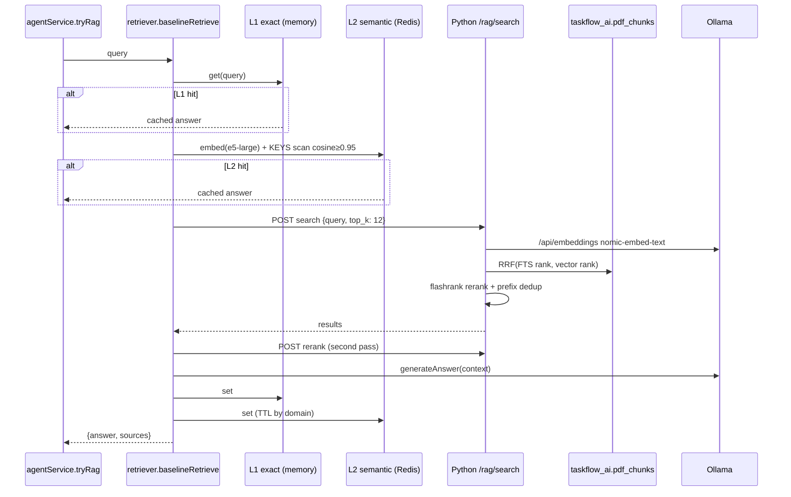
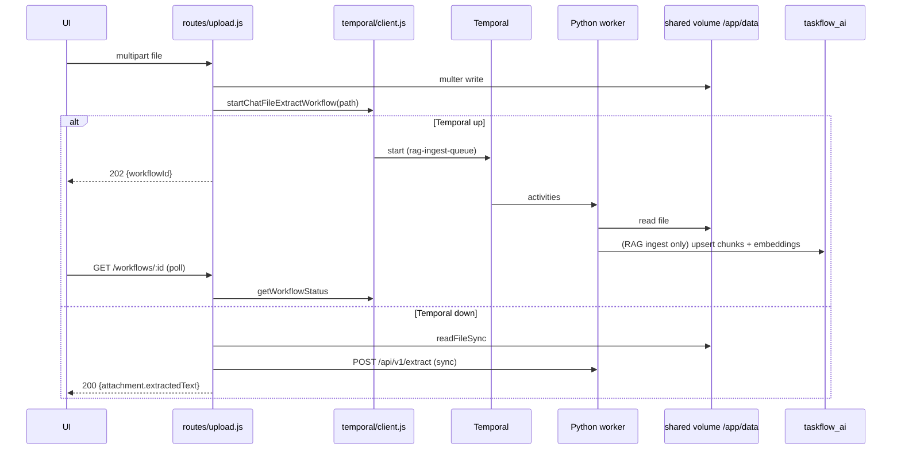
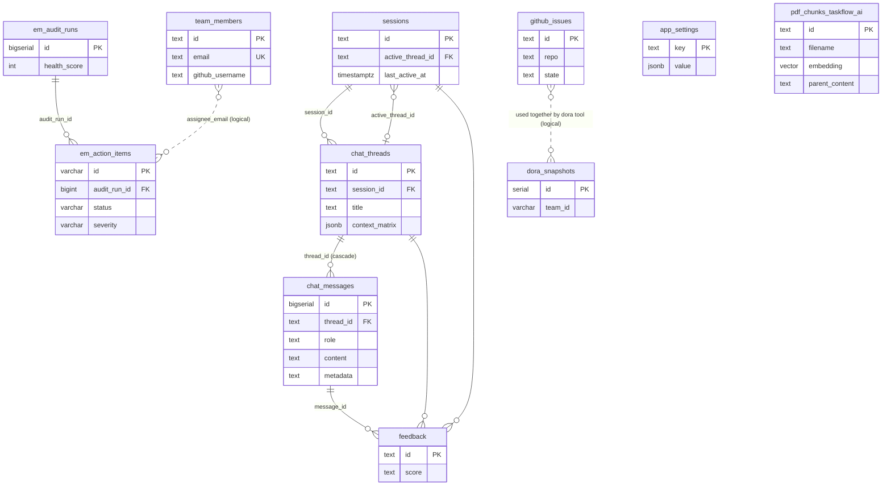

# EM TaskFlow AI — Codebase Deep Dive

> Scope: a static read of the repository at commit `b238464`. Nothing was executed: `node_modules` were not installed, so neither test suite was run. Every claim cites `path:line` or `file → function`. Anything not directly verified in code is marked **(inferred)**.
>
> Where `CLAUDE.md`/`README.md` disagree with the code, this document follows the code and says so.

## 0. Plan & prioritisation

The repo has ~460 tracked files and ~28.6k lines of backend/Python source. Coverage priority:

1. **Deep:** the Node backend request path (`backend/src/index.js` → routes → `ChatApplicationService` → `agentService` → router / supervisor / domain harnesses → integrations → Postgres/Redis/Python service).
2. **Deep:** the Python AI service (RAG storage/search/rerank, Temporal ingest).
3. **Medium:** Temporal jobs (audit, team sync, HITL Slack), caching, settings/secrets, compose/CI.
4. **Light:** frontend SPA, the `evaluations/` engine, the VitePress `docs/` site, the per-agent business logic (10 agents follow one pattern, so one agent, `doraAgent.js`, is examined closely).

---

## 1. Overview

**What it does.** It is an "engineering-manager copilot". An EM asks questions in a chat UI, such as "What are our DORA metrics?", "Draft SBI feedback for X", or "Summarize the uploaded runbook". The backend:

- classifies the query,
- routes it to one or more of 10 EM domain "agents" (DORA, delivery, SBI, people, sprint, retro, roadmap, OKR, SOP, critic),
- grounds answers in live GitHub/Jira/Notion/Slack/Google Calendar data, with PostgreSQL snapshot fallbacks, or in uploaded documents (RAG),
- answers with a local Ollama model by default.

Background Temporal jobs run an autonomous "EM health audit" that produces action items for an **Action Hub**. They also reconcile team identities across tools. An **Admin Portal** manages integration credentials, cache, evaluations and the team roster.

**Users.** A single engineering manager, or a small team, running the stack locally with docker-compose **(inferred)**. There is no user model and no authentication (see §7), so the system is effectively single-tenant.

**Stack (versions from manifests):**

| Layer | Tech | Source |
|---|---|---|
| Backend | Node.js (Docker `node:22-bullseye-slim`; `.nvmrc` = 20.15.0; CI = 22), ESM (`"type": "module"`), Express 4.18.2 | `backend/package.json`, `backend/Dockerfile:1`, `backend/.nvmrc` |
| Agents | `langchain` ^1.2.24 (`createAgent`), `@langchain/langgraph` ^1.1.4, `@langchain/langgraph-supervisor` ^1.0.1, `@langchain/openai` (used as the Ollama client via its OpenAI-compatible API) | `backend/src/agent/baseAgent.js:7`, `backend/src/llm/index.js:36-48` |
| Validation | zod 3.25.76 | `backend/src/config.js:2`, `backend/src/routes/v1/chat.js:10` |
| DB driver | `pg` ^8.13.1 | `backend/src/db/postgres.js:1` |
| Cache | `ioredis` ^5.11.1; in-process `@huggingface/transformers` embeddings (`Xenova/multilingual-e5-large`) | `backend/src/cache/semanticCache.js`, `backend/src/llm/bgeEmbeddingsClient.js:4` |
| Orchestration | Temporal (`@temporalio/*` ^1.11–1.22 Node; `temporalio==1.6.0` Python; server `temporalio/auto-setup:1.24.2`) | `docker-compose.yml:191` |
| Telemetry | Langfuse (`langfuse`/`langfuse-langchain` ^3.35; server `langfuse/langfuse:2`), pino ^10 + `@axiomhq/pino`, Sentry, New Relic, optional OpenTelemetry | `backend/src/utils/tracer.js`, `backend/src/utils/logger.js` |
| Python AI service | Python ≥3.12, FastAPI 0.110, uvicorn 0.28, psycopg 3.1, PyMuPDF 1.23, flashrank 0.2.2, grpcio, deepeval, ragas, langchain-ollama | `services/python-ai-service/pyproject.toml` |
| Frontend | **React ^19.1.0** (CLAUDE.md says 18), Vite ^8.1.5, `@assistant-ui/react` ^0.14.27 | `frontend/package.json` |
| Storage | PostgreSQL 16 + pgvector (`pgvector/pgvector:pg16`), Redis 7-alpine, separate Postgres 16 for Langfuse | `docker-compose.yml:109,131,145` |
| LLM | Ollama `hermes3:8b` (default). OpenAI/Anthropic/Google providers exist but are disabled by default | `backend/src/config.js:52-70` |
| Docs | VitePress site in `docs/` | `docs/.vitepress/config.js`, `.github/workflows/deploy-docs.yml` |

---

## 2. How to run it

### Commands

| Task | Command | Where defined |
|---|---|---|
| Full stack | `docker compose up -d --build` | `docker-compose.yml` |
| Backend dev | `cd backend && npm run dev` *(not defined; see note)* / `npm start` → `node src/index.js` | `backend/package.json` scripts |
| Backend debug | `npm run start:debug` (inspector on 0.0.0.0:9229) | `backend/package.json` |
| Backend build | `npm run build` is a no-op echo | `backend/package.json` |
| Backend tests | `npm test` → nyc + jasmine, `DATABASE_URL=…/taskflow_test` | `backend/package.json`, `backend/jasmine.json` |
| Evals | `npm run evaluate`, `eval:multi-agent`, `eval:rag`, `eval:pre-llm`, `eval:promptfoo` | `backend/package.json` |
| Python service | `cd services/python-ai-service && python app/main.py` (REST :8000 + gRPC :50051) | `services/python-ai-service/Dockerfile` CMD |
| Python tests | `uv run pytest` (testpaths=`tests`) | `pyproject.toml [tool.pytest.ini_options]` |
| Frontend | `cd frontend && npm start` (vite :3000, proxies `/api` → 127.0.0.1:4000), `npm run build` | `frontend/package.json`, `frontend/vite.config.js` |
| Docs site | `npm run docs:dev` / `docs:build` (root) | root `package.json` |
| Nightly eval | `scripts/run-nightly-eval.sh`, macOS launchd plist `scripts/com.emtaskflow.nightly-eval.plist` | `scripts/` |

Notes on the commands:

- **`npm run dev` does not exist** in `backend/package.json`. The root `package.json` `dev` script delegates to it, so it fails. CLAUDE.md lists it.
- **No lint step exists anywhere.** No ESLint/Prettier/ruff config or script. The frontend `eslintConfig` extends `react-app`, but `react-scripts` is not a dependency.
- **Frontend tests (`*.test.js`) have no runner**: there is no jest/vitest dependency or `test` script (`frontend/package.json:12-16`). The root `frontend:test` script therefore fails.
- Root scripts reference Python files that are **not in the repo**: `evaluation/ragas_runner.py` and `evaluation/trulens_rag_triad.py`. The admin route also references `evaluation/replay_langfuse_traces.py` (`backend/src/routes/admin.js:589`).

### Configuration

- **Backend env** is parsed by a zod schema in `backend/src/config.js:24-103`. An optional `backend/src/config/local.json` is shallow-merged over it (`config.js:329-366`; that directory does not exist in the repo). `backend/.env.example` is the template, and compose loads `backend/.env` via `env_file` (`docker-compose.yml:42`).
- Key backend vars:
  - `NODE_ENV`, `RUNTIME_MODE` (`rag_only`|`full`), `PORT`, `HOST`, `DATABASE_URL`
  - `ROUTER_ROLLOUT_MODE` (`off`|`shadow`|`enforced`), `ROUTER_*` thresholds
  - `OLLAMA_BASE_URL`, `LLM_*`
  - `MCP_{NOTION,JIRA,GITHUB,GOOGLE}_ENABLED`, `JIRA_*`, `GITHUB_TOKEN`, `NOTION_API_KEY`
  - `ENABLE_<DOMAIN>_AGENT` (×10), `LEGACY_*_API_ENABLED`
  - `PYTHON_AI_SERVICE_URL`, `TEMPORAL_HOST`
  - `LANGFUSE_*`, `SENTRY_DSN`, `AXIOM_TOKEN`/`AXIOM_DATASET`, `OTEL_ENABLED`
  - `FRONTEND_URL`, `GITHUB_OWNER`/`GITHUB_REPO`
- **Runtime settings** (integration tokens, model choice) are also stored in Postgres `app_settings`. They are mirrored to `settings-backup.json` on disk and pushed into `process.env` on load (`backend/src/services/settingsService.js:96-126,385-415`). So the effective config comes from env, DB and the disk backup combined.
- **Python env:** `POSTGRES_{HOST,PORT,DB,USER,PASSWORD}` (`rag_processor/database.py:22-27`), `OLLAMA_BASE_URL`, `RAG_EMBEDDING_MODEL`, `TEMPORAL_HOST`, `REST_PORT`, `GRPC_PORT`, `SENTRY_DSN`, `NEW_RELIC_LICENSE_KEY`, `OTEL_ENABLED`.
- **Postgres init:** `docker/postgres/init-databases.sql` creates `taskflow_backend`, `taskflow_ai`, `*_test`, and `*_eval`.

### CI/CD

- `.github/workflows/ci.yml` and `.github/workflows/backend-ci.yml` largely **duplicate** each other. Both:
  - run on push/PR to `main`/`develop`,
  - `npm ci --legacy-peer-deps && npm test`,
  - install Ollama and pull `hermes3:8b` (a multi-GB model) on the runner,
  - run `npm run evaluate`.

  `ci.yml` also runs `uv sync && uv run pytest` with Ollama.
- **Neither workflow starts a Postgres or Redis service.** Tests rely on in-memory seeding (`backend/test/setup.js:17-27`). Any spec that needs a real DB either mocks it or silently degrades.
- The "Display CI Summary" steps **echo hard-coded success counts** ("All 155 Node.js Unit Specs Passed", "32 Python AI Pytest specs passed"). They run `if: always()`, so the summary claims success even when the job failed. These counts also disagree with CLAUDE.md (319/240 and 45/39). The repo has ~394 `it(` blocks under `backend/test`.
- `deploy-docs.yml` publishes the VitePress site **(inferred from its name and the VitePress config)**.
- There is **no deploy pipeline** for the application itself. Deployment means running docker-compose (see `docs/operations/deployment.md`).

---

## 3. Architecture

### Folder responsibilities

| Path | Responsibility |
|---|---|
| `backend/src/index.js` | Process bootstrap, Express app, middleware, startup init sequence |
| `backend/src/config.js` | zod env schema → typed config object + getters |
| `backend/src/routes/` | HTTP layer. `v1/index.js` mounts everything; `api.js` re-mounts v1 under `/api` with deprecation headers |
| `backend/src/middleware/` | Request IDs + in-memory rate limiting (`hardening.js`); session resolution (`sessionContext.js`) |
| `backend/src/application/` | Use-case services (chat, session, conversation, feedback, health, upload) |
| `backend/src/services/` | Domain services: `agentService` (orchestrator), `settingsService`, `identityService`, `githubSyncService`, `preRouterRewriter`, `episodicMemory`, `sessionFactMatrix`, `SessionCleanupWorker` (unwired) |
| `backend/src/agent/` | LLM router (`llmRouter.js`), supervisor graph (`graph.js`), 10 domain agents + their deterministic tools, prompts, `baseAgent.js` factory |
| `backend/src/mcp/` | "MCP" tool wrappers. Despite the name, these are LangChain `DynamicStructuredTool`s over REST clients, not MCP-protocol clients (`mcp/index.js:93-95` `getMCPClient()` returns `null`). Also OAuth helpers and `baseToolHarness.js` (3-tier fallback harness) |
| `backend/src/integrations/clients/` | axios REST clients for GitHub, Jira, Notion, Slack, Google Calendar (`BaseIntegrationClient.js`) |
| `backend/src/db/postgres.js` | A single 2.4k-line `DatabaseService` holding DDL, all queries and in-memory fallbacks |
| `backend/src/persistence/` | Thin repository facades over `DatabaseService` |
| `backend/src/rag/` | RAG facade (`index.js`), retriever (baseline/agentic + HyDE + caches), ingest |
| `backend/src/cache/` | L1 exact (in-process), L2 semantic (Redis + in-memory), tool cache (stats only), invalidator |
| `backend/src/grpc/client.js` | Python-service client. **Despite the name it is pure REST/axios** (`grpc/client.js:6,10`); there is no `@grpc/*` dependency |
| `backend/src/temporal/` | Node worker (`team-sync-queue`), client helpers, workflows, activities |
| `backend/src/workers/teamSyncWorker.js` | `setInterval` 6-hour team sync |
| `backend/src/utils/` | logger (pino), tracer (Langfuse), DORA math, response formatter |
| `services/python-ai-service/app/` | FastAPI REST + gRPC servicer; PDF/DOCX/tabular extraction; chunker; flashrank reranker; pgvector DB; shadow evaluator; Temporal worker (`rag-ingest-queue`) |
| `evaluations/engine/` | Standalone Python eval CLI + Temporal eval worker (`eval-task-queue`) — DeepEval, Ragas, pairwise arena |
| `frontend/src/` | React SPA: `Chat`, `AdminPage` (`/admin`), `ActionHubPage` (`/actions`), `apiClient.js` |
| `proto/ai_service.proto` | gRPC contract for the Python service; no Node consumer |
| `.agents/`, `AGENTS.md`, `GEMINI.md`, `SKILLS.md` | Instructions for AI coding assistants |

### Communication

- Browser → **nginx** (frontend container, `frontend/docker/nginx.conf:22-23`, `proxy_pass http://backend:4000/api/`), or → Vite proxy in dev.
- Backend → **Python AI service** over HTTP REST (`PYTHON_AI_SERVICE_URL`, default `http://localhost:8000`). The backend never uses port 50051.
- Backend → **Ollama** through the OpenAI-compatible endpoint `${OLLAMA_BASE_URL}/v1` (`llm/index.js:36-48`).
- Python → **Ollama** `/api/embeddings` for `nomic-embed-text` (`database.py:86-112`).
- Both → **Postgres**. They use separate databases (`taskflow_backend` vs `taskflow_ai`) on the same server.
- Backend → **Redis** at hard-coded `redis://redis:6379`, then `redis://localhost:6379` (`semanticCache.js:156-158`, `sessionFactMatrix.js:33-35`). There is no env var for it.
- Backend ↔ **Temporal**. The Node worker is embedded in the backend process (`index.js:158-160`). The Python worker is embedded in the FastAPI process (`main.py:116-119`). The two languages share Temporal but use separate task queues:
  - Node `team-sync-queue`;
  - Python `rag-ingest-queue`;
  - eval engine `eval-task-queue`.
- Backend → GitHub / Jira / Notion / Slack / Google APIs via axios.
- Backend/Python → Langfuse, Sentry, New Relic, Axiom (telemetry).
- Backend → Python **shared volume** `backend_data:/app/data` (`docker-compose.yml:24-25,83-84`). Temporal ingest workflows pass a local file path that the Python worker reads (`python temporal/activities.py:42-48`).



---

## 4. Entry points

| Entry point | How it starts | What happens |
|---|---|---|
| **Backend HTTP server** | `node src/index.js` (`backend/package.json` start; Dockerfile CMD loads New Relic's ESM loader **(inferred from the Dockerfile comment at line ~20)**) | See the startup sequence below |
| **Node Temporal worker** | `startTemporalNodeWorker()` called from `index.js:159-160` | Skipped when `NODE_ENV=test` (`temporal/worker.js:16`). Connects to `TEMPORAL_HOST` (default `temporal:7233`), queue `team-sync-queue`, then registers the `em-autonomous-audit-schedule` cron `0 */4 * * *` (`temporal/client.js:410-438`). Workflows: `slackPostHITLWorkflow`, `teamAutoDiscoveryWorkflow`, `emAutonomousAuditWorkflow`, `cacheInvalidationWorkflow` (`temporal/workflows.js`) |
| **teamSyncWorker** | `teamSyncWorker.start()` at `index.js:158` | Warm-up `setTimeout`, then `setInterval` every 6h (`workers/teamSyncWorker.js:18-37`) |
| **SessionCleanupWorker** | **Never started.** No import anywhere in `src/` | `SESSION_CLEANUP_*` config (`config.js:99-102`) is dead, so inactive sessions are never purged |
| **Python service** | `python app/main.py` (Dockerfile CMD) | gRPC server on `GRPC_PORT` (thread pool 10, insecure) (`main.py:120-132`), then `uvicorn.run("app.main:app")` (`main.py:135-141`). The FastAPI `startup` event spawns the Temporal worker (`main.py:116-119`) on `rag-ingest-queue`, which handles workflows `RAGIngestWorkflow`, `ChatFileExtractWorkflow`, `PromptEvaluationWorkflow`, `TruLensBatchEvaluationWorkflow`, `DeepEvaluationBenchmarkWorkflow`, `TraceReplayWorkflow` (`app/temporal/workflow.py`). A nightly schedule (`0 2 * * *`) is defined in `app/temporal/schedules.py:22-73` |
| **Eval engine worker** | `evaluations/engine/temporal/worker.py` | Queue `eval-task-queue` (`worker.py:27`), max concurrency 2 |
| **Eval CLIs** | `backend/evaluation/run-evaluation.js`, `evaluators/*.js`, `evaluations/engine/cli.py`, `scripts/run-nightly-eval.sh` | Batch evaluation against golden datasets |
| **Admin-spawned processes** | `POST /api/v1/admin/eval/run-deep-benchmark` → `spawn('bash', [runnerScript])` (`routes/admin.js:441`); `POST /eval/replay-traces` → `spawn('uv', …)` (`admin.js:589`) | Long-running child processes, tracked in module-level state objects |
| **Promptfoo server** | `backend/src/scripts/promptfooServer.js` (excluded from coverage) | Local prompt-matrix server **(inferred)** |
| **Ad-hoc scripts** | `backend/test-agent.js`, `backend/test-minimal.js`, `backend/scripts/clean-database.js` | Developer utilities |

**Backend startup sequence** (`index.js:95-185`). Every step is wrapped in try/catch with `warn`, so the server starts even when dependencies are down:

1. `import './tracing.js'`. This is now a no-op stub (`tracing.js:8`).
2. `dotenv`.
3. Sentry if `SENTRY_DSN` is set.
4. OpenTelemetry SDK only if `OTEL_ENABLED=true`, because of a New Relic ESM hook conflict (`index.js:28-51`).
5. Express middleware chain: `cors()` (open to every origin), `attachRequestContext`, `createRateLimiter()`, `express.json({limit:'2mb'})`, request logging. Routers are mounted at `/api/v1` and `/api` (`index.js:63-83`).
6. In `startServer()`, in order:
   - `validateConfig()`, which only warns;
   - `db.initialize()`, which creates tables (§6);
   - `initializeLLM()`;
   - `initializeIngest()`;
   - `initSemanticCache()` and `initFactMatrixRedis()`, both of which degrade gracefully;
   - if `RUNTIME_MODE=full`, `initializeMCP()` followed by `langGraphAgentService.initialize()`. The latter compiles the supervisor and, if it fails, retries lazily on the first query;
   - the team sync worker and the Temporal worker;
   - `app.listen(PORT, HOST)`.
7. `SIGINT` closes the DB pool and exits. There is no `SIGTERM` handler, and Docker sends SIGTERM **(inferred risk)**.

---

## 5. End-to-end flows

### Flow A — Chat query (`POST /api/v1/chat`) — the core flow

1. **Trigger.** The frontend `apiClient` posts to `/api/v1/chat` (`frontend/src/services/apiClient.js:6-46`).
2. **Middleware.** `attachRequestContext` assigns a UUID (`middleware/hardening.js:15-20`). The rate limiter allows 120 req/min per key (`hardening.js:22-48`). `attachSessionContext` (`middleware/sessionContext.js:3-27`) → `SessionApplicationService.resolveSession` reads the session id from `?sessionId`/`?session`, the `x-session-id` header, or the cookie, in that order (`SessionApplicationService.js:12-17`). It creates a session if none is found and sets an `HttpOnly; SameSite=Lax` cookie (`:110-120`).
3. **Validation.** zod `chatSchema` checks `message` 1..100k, optional `threadId`, `mode` (`baseline|advanced`) and `attachments` (`routes/v1/chat.js:10-21,34-44`). Failure returns 400 with field details.
4. **Use case** `ChatApplicationService.processChat` (`ChatApplicationService.js:55-200`):
   - `threadRepo.ensureThread(threadId || session.threadId, title, sessionId)`. This creates the thread, or returns any existing thread with that id (`db/postgres.js:759-842`, no ownership check).
   - Loads the last 50 messages and the thread "fact matrix" (Redis first, then DB `chat_threads.context_matrix`, per `sessionFactMatrix.js:72-87`).
   - `optimizeChatHistory` keeps an 8-turn window plus a summary anchor within a 2,500-char budget (`:395-466`).
   - `preRouterRewriter.resolveQuery` resolves coreference.
   - `episodicMemoryService.retrieveRelevantPastContext`.
5. **Orchestration** `agentService.processQuery` (`services/agentService.js:102-299`):
   - Lazy `initialize()`, then `ensureLlmReadyForQuery()`.
   - Creates a Langfuse root trace (`utils/tracer.js` → `createEndToEndTrace`).
   - `getRolloutDecision` returns a hash-bucketed `off|shadow|enforced` mode.
   - **Enforced path:**
     - If the query is a bare confirmation ("yes", "ok", …) and the last assistant message was a clarification, it re-runs the original user message with its saved plan (`:166-205`).
     - **Routing** `routeQueryPlan` → `llmRouter.getRouterChain().invoke` (`agent/llmRouter.js:384-470`):
       1. `classifyFastPath` (regex; covers code/math/greeting/conceptual/follow-up) returns `DIRECT_LLM`, `ATTACHMENT_DIRECT` or `CONTEXTUAL_SYNTHESIS` with no LLM call (`llmRouter.js:78-205`).
       2. Otherwise the LLM is prompted with a 14-rule system prompt and asked for JSON. The response is parsed after stripping `<think>`, with truncated-JSON repair as a fallback.
       3. If parsing still fails, `getDeterministicFallbackPlan` uses keyword routing (`:244-380`).
       4. `normalizeRoutingPlan` filters `VALID_DOMAINS` and clamps confidence (`agentService.js:589-605`).
     - If `confidence < 0.45` the result is a **clarification** (`agentService.js:216-221`).
     - Otherwise `runEnforcedPolicy` (`:335-451`) picks the first matching branch:
       1. Fast-path intents → `runLlmExecutor`, a plain LLM call.
       2. A pure RAG intent → `tryRag` → `ragService.baselineRetrieve`/`agenticRetrieve` (Flow B). A zero-hit returns a canned "upload a document" message.
       3. One or more EM domains → `runRequiredDomainRecovery` (`:453-565`). It **bypasses the supervisor**, invokes the deterministic domain tools directly and in parallel (`Promise.all`), with `mode=LIST_RAW|ANALYZE` and `target` chosen by keyword, and joins the `data.summary` strings. This is the main path for EM questions.
       4. Raw integration domains (`jira`/`github`/`notion`/`calendar`/`slack`) with MCP ready → `executeAgentQuery` on the LangGraph supervisor (`agent/graph.js:474-563`, `recursionLimit` 25), then `validatePolicy`, then recovery or RAG fallback.
       5. Otherwise a "could not gather tool-backed evidence" message, or LLM-only.
   - **Tool harness.** Each domain tool is built with `createDeterministicToolHarness` (`mcp/baseToolHarness.js:18-160`):
     1. Feature-flag check.
     2. `CONCEPTUAL_ONLY` short-circuit.
     3. For each `source`, in parallel: Tier 1 `mcpExecutors[src]` → Tier 2 `directApiExecutors[src]` → Tier 3 `dbCacheFallback` (sets `staleDataWarning`).
     4. `computeMath`.

     For DORA, Tier 1 is `safeExecuteMCPTool('get_dora_events')` with a 2.5s race timeout (`agent/baseAgent.js:56-78`). That calls `mcp/github.js` → `GitHubClient`. Tier 3 reads `dora_snapshots` + `github_issues` (`agent/doraAgent.js:64-111`).
   - **Response shaping.** `buildEvidenceBySource`, then `buildEmResponse` (`utils/responseFormatter.js`). The Langfuse trace is updated and flushed asynchronously.
6. **Post-processing** back in `processChat`:
   - If the routed domains include github/notion, check OAuth status. This may *replace the answer* with a "connect GitHub/Notion" message (`:97-113`).
   - Persist the user and assistant messages to `chat_messages` (two separate inserts with no transaction; `:122-144`).
   - Update the thread title.
   - Fire-and-forget the **shadow eval** POST to Python (`:202-222`) and the fact-matrix delta save (`:164-174`).
7. **Response.** JSON `{messageId, threadId, threadTitle, sessionId, answer, sources, traceId, feedbackToken, meta, requestId}`.

**Failure paths:**

- Thrown errors become 504 when the message contains "timed out", 503 for "LLM unavailable", and 500 otherwise (`routes/v1/chat.js:55-66`).
- Router failure → keyword fallback plan. Tool failure → `{status:'FAILED'}` per domain. Recovery with no success returns `null`, which falls through to the RAG or "tooling-required" message.
- DB failure inside `ensureThread` propagates to the 500 handler.
- An error inside `attachSessionContext` is passed to `next(err)`. No custom error middleware exists, so Express returns its default HTML 500 page.



### Flow B — RAG answer (inside Flow A, or `POST /api/v1/rag/documents/:id/query`)

1. `ragService.baselineRetrieve(query)` (`rag/index.js:81`) → `retriever.baselineRetrieve` (`rag/retriever.js:20-88`).
2. **L1 exact cache.** In-process Map keyed by the normalised query plus domain/user/repo (`cache/l1ExactCache.js`). A hit returns immediately.
3. **L2 semantic cache.** `checkSemanticCache` (`cache/semanticCache.js:280-288`):
   - embeds the query in-process with transformers.js `multilingual-e5-large` (`llm/bgeEmbeddingsClient.js:4-14`);
   - runs `redisClient.keys('semcache:<domain>:*')` and scans every entry linearly with cosine similarity, threshold 0.95, plus an entity-alignment gate (`semanticCache.js:215-277`);
   - falls back to an in-memory map.
4. **Retrieve.** `baseRetrieve` → `databaseService.hybridSearchPdfChunks` (`db/postgres.js:1349-1361`) → `pythonAIServiceClient.searchRAG` → `POST {PY}/api/v1/rag/search` (`grpc/client.js:95-121`, 30s timeout). On the Python side, `rest_router.search_rag` (`rest_router.py:81-104`):
   - `RAGDatabaseService.hybrid_search` embeds the query via Ollama `nomic-embed-text`;
   - if an embedding was obtained, it runs a two-CTE **RRF** query: FTS rank via `websearch_to_tsquery`, plus pgvector `<=>` rank, scored as `1/(60+rank)` (`database.py:234-300`); otherwise FTS only;
   - then flashrank rerank (`ms-marco-TinyBERT-L-2-v2`, `reranker.py:20-24`) and a 120-char-prefix dedup that the code calls "MMR".
5. Node **reranks again** via `POST /api/v1/rag/rerank` (`grpc/client.js:181-228`).
6. `generateAnswer` makes the LLM call (`retriever.js:368-412`). The result is written to L1 and L2.
7. **Agentic mode** (`agenticRetrieve`, `retriever.js:90-225`) adds LLM query rewriting, a HyDE hypothetical document and LLM compression.

**Failure paths:** Python down → `searchRAG` returns `[]` → zero-hit guidance. Rerank failure → first N candidates. LLM failure → `"I encountered an error during retrieval: …"` returned *as the answer* (`retriever.js:76-84`). Cache errors are swallowed.



### Flow C — Document upload & ingestion

There are two entry points:

- **RAG/knowledge-base upload:** `POST /api/v1/rag/upload` or `/rag/ingest`. Uses `multer({dest: pdfDir})` with **no size limit** (`routes/rag.js:30,57-58`), then `handleFileUpload` → `startRAGIngestWorkflow(filePath, filename)` on `rag-ingest-queue` (`temporal/client.js:47-70`).
- **Chat attachment:** `POST /api/v1/chat/upload`. Uses multer disk storage with a 50 MB limit (`routes/upload.js:20-30`). It tries `startChatFileExtractWorkflow` and returns **202** `{workflowId}` (`upload.js:47-58`). If Temporal is unavailable it falls back synchronously: `readFileSync` → `pythonAIServiceClient.extractDocument` → **200** with the extracted text (`upload.js:63-84`). The client polls `GET /chat/upload/workflows/:workflowId` (`upload.js:99+`) → `getWorkflowStatus` (`temporal/client.js:97-132`).

The Python `RAGIngestWorkflow` (`app/temporal/workflow.py:33-81`) runs three activities, each with 3 attempts and 1–10s backoff:

1. `extract_text_activity` reads the file from the shared volume (`activities.py:26-95`).
2. `chunk_text_activity` uses 512-token chunks with 64-token overlap and a windowed parent context (prev/cur/next) (`chunker.py:9-70`).
3. `persist_and_embed_activity` → `upsert_chunks`, which embeds each chunk via Ollama and inserts into `pdf_chunks` with `vector(768)` (`database.py:114-188`).

The extracted text and the chunk list travel **through Temporal payloads**. Large documents can exceed Temporal's payload/history size limits **(inferred)**.

Failure: the activity is retried, then the workflow fails, and the poll endpoint reports the status. If embedding fails the chunk is stored without a vector and only FTS can find it (`database.py:86-112` returns `None`).



### Flow D — Autonomous EM audit → Action Hub

1. **Triggers:**
   - the Temporal schedule `em-autonomous-audit-schedule`, every 4h (`temporal/client.js:410-438`);
   - `POST /api/v1/actions/audit/trigger` (`routes/actions.js:162-223`);
   - `POST /api/v1/admin/audit/trigger` (`admin.js:1133`).
2. `emAutonomousAuditWorkflow` (`temporal/workflows.js:145-182`) runs four harvest activities in parallel (`activities.js:456-684`): DORA+delivery, people+cadence, sprint+OKR, and SOP. Activity options are a 45s start-to-close timeout with 2 attempts (`workflows.js:8-14`).
3. `synthesizeAuditAndActionItemsActivity` (`activities.js:685-838`):
   - starts at score 100 and deducts points per finding (for example, a stalled PR costs 5–10);
   - builds action items with **deterministic IDs** for dedup;
   - `createAuditRun` writes to `em_audit_runs`;
   - `upsertActionItems` writes to `em_action_items` one row at a time with `INSERT … ON CONFLICT (id) DO UPDATE` and no transaction (`db/postgres.js:2099-2200`).
4. `dispatchSlackAuditNotificationActivity` posts to Slack (`activities.js:840-883`).
5. If Temporal is unavailable, the route runs the same activity functions **in-process** (`actions.js:181-211`).
6. **Consumption:** the Action Hub UI reads `GET /actions`, `/actions/summary` and `/actions/audit-runs`; `PATCH /actions/:id` updates the status (`actions.js:139-159`); `POST /:id/nudge` and `/batch` cover nudges and bulk updates.

```mermaid
sequenceDiagram
  participant SCH as Temporal schedule / POST audit/trigger
  participant WF as emAutonomousAuditWorkflow
  participant ACT as activities.js
  participant EXT as GitHub/Jira/GCal/Notion
  participant DB as Postgres
  participant SL as Slack
  participant UI as Action Hub
  SCH->>WF: start (triggeredBy)
  par harvests
    WF->>ACT: harvestDoraAndDelivery
    WF->>ACT: harvestPeopleAndCadence
    WF->>ACT: harvestSprintAndOkr
    WF->>ACT: harvestSopAndGovernance
  end
  ACT->>EXT: API calls (fallback to DB snapshots)
  WF->>ACT: synthesizeAuditAndActionItems
  ACT->>DB: INSERT em_audit_runs; UPSERT em_action_items
  WF->>ACT: dispatchSlackAuditNotification
  ACT->>SL: chat.postMessage
  UI->>DB: GET /actions, PATCH /actions/:id (via backend)
```

### Flow E — Human-in-the-loop Slack post

1. `POST /api/v1/admin/temporal/slack-post/request` → `startSlackPostHITLWorkflow` (`admin.js:1015`, `temporal/client.js:263+`).
2. The workflow registers the `approveSlackPost` and `rejectSlackPost` signals and waits on `condition(...)` with a `timeoutMinutes` timeout, default 60 (`workflows.js:28-58`).
3. `POST …/approve` and `POST …/reject` send `signalSlackPostApproval` (`admin.js:1048,1079`).
4. On approval, `postSlackMessageActivity` posts the message, optionally with an overridden channel or text (`workflows.js:88-110`). Otherwise the workflow returns `REJECTED` or `TIMED_OUT`.
5. Status is read with `GET …/status`.

Failure: if the timeout elapses the workflow returns `TIMED_OUT`. The Slack activity retries twice.

---

## 6. Data model

### Stores

| Store | Owner | Contents |
|---|---|---|
| Postgres `taskflow_backend` | Node `DatabaseService` | Sessions, threads, messages, feedback, settings, team, EM snapshots, audit/action items, plus a **legacy unused `pdf_chunks`** table |
| Postgres `taskflow_ai` | Python `RAGDatabaseService` | `pdf_chunks` with `embedding vector(768)`, an HNSW cosine index and a GIN FTS index (`database.py:37-84`) |
| Postgres `temporal` | Temporal auto-setup | Workflow state **(inferred: created by the auto-setup image, not by `init-databases.sql`)** |
| Postgres `langfuse_db` (analytics-db :5433) | Langfuse | Traces/scores |
| Redis | Node | `semcache:<domain>:<hash>` (semantic cache with TTL per domain, `semanticCache.js:14-26`), `thread:fact_matrix:<threadId>` (`sessionFactMatrix.js:8`) |
| Process memory | Node | L1 exact cache, rate-limit buckets, admin job state, and in-memory fallbacks for every table (`db/postgres.js:10-18`) |
| Disk | Node | `settings-backup.json` (contains plaintext secrets), multer upload dirs, `reports/evaluations/*.json` |

### Entities (`taskflow_backend`, DDL in `db/postgres.js:74-343`)

- `sessions(id PK, active_thread_id → chat_threads, client_info, created_at, updated_at, last_active_at, archived*)`. The `archived` column is added lazily by `archiveSession` (`postgres.js:643`).
- `chat_threads(id PK, session_id → sessions ON DELETE SET NULL, title, context_matrix JSONB, …)`
- `chat_messages(id BIGSERIAL, thread_id → chat_threads CASCADE, role CHECK(user|assistant|system), content, strategy, executor_path, trace_id, citations_json TEXT, metadata TEXT, created_at)`. JSON is stored as TEXT here, as JSONB elsewhere.
- `feedback(id, session_id, thread_id, message_id → chat_messages, trace_id, score, comment, metadata)`
- Legacy tables: `chat_history`, `user_preferences`, `task_cache`
- `github_issues(id PK, issue_number, repo, title, state, assignee, html_url, labels_json, data_json, synced_at)`. Written by `githubSyncService` through `upsertGithubIssues`, the only transactional write in the file (`postgres.js:1175-1245`, `BEGIN/COMMIT/ROLLBACK` at 1203/1237/1240).
- EM snapshots: `dora_snapshots`, `sbi_feedback_records`, `sprint_analytics`, and **`okr_tracker`** (CLAUDE.md calls it `okr_records`).
- `app_settings(key PK, value JSONB, source)`. Holds the `llm` and `mcp` documents with integration tokens in plaintext. A monkey-patched `pool.query` blocks `TRUNCATE/DROP/DELETE` on this table (`postgres.js:36-49`).
- `team_members(id, display_name, email UNIQUE, aliases, github_username, jira_email, jira_account_id, gcal_email, notion_name, levels, track, tenure, skills)`. Written by team sync/`identityService` and admin CRUD.
- `em_audit_runs(id, triggered_by, status, health_score, summary_markdown, *_summary JSONB…)`
- `em_action_items(id VARCHAR PK, audit_run_id → em_audit_runs, title, category, severity, status, assignee_*, external_reference, resolution_notes, completed_*)`



### Migrations

There is **no migration framework**. The schema is created idempotently on each boot:

- **Node:** `CREATE TABLE IF NOT EXISTS` plus `ALTER TABLE … ADD COLUMN IF NOT EXISTS` statements run sequentially in `createTables()` (`postgres.js:74-343`). One FK is added through a "catch 'already exists'" pattern (`:163-172`). `archiveSession` performs DDL at request time (`:642-644`).
- **Python:** the same approach in `_ensure_table_exists` (`database.py:37-84`), which also creates the `vector` and `pg_trgm` extensions.

There are no down-migrations and no versioning, and renames or type changes are impossible without manual SQL.

---

## 7. Cross-cutting concerns

- **Authentication / authorization: none.**
  - No auth middleware exists (only `middleware/hardening.js` and `sessionContext.js`).
  - Every `/api/v1/admin/*` route is public: the full settings CRUD including credentials, `POST /system/reset-data` (truncates tables), process spawning, cache flush, team CRUD and Slack posting.
  - `GET /api/v1/sessions` lists every session (`routes/v1/sessions.js:29-46`).
  - `GET /threads/:threadId/messages` returns any thread's messages without checking the session (`sessions.js:178-196`).
  - The "session" is a bearer identifier that can arrive in the query string (`SessionApplicationService.js:15`). That enables session fixation via shared links **(inferred)**.
  - `cors()` is open to every origin (`index.js:63`).
  - OAuth flows exist only for *outbound* integrations: Jira PKCE (`mcp/jiraOAuth.js`) and GitHub/Notion (`mcp/*OAuth*.js`).
- **Config & secrets.**
  - zod-validated env (`config.js`). Integration secrets live in plaintext in `app_settings`, in `settings-backup.json`, and in `process.env` (set at `settingsService.js:385-415`). `GET /admin/settings` masks them (`settingsService.js:16-47,450-502`).
  - **`docker-compose.yml` hard-codes real-looking fallback credentials** for Langfuse public/secret keys, a Sentry DSN, a New Relic license key and an Axiom token (`docker-compose.yml:14-20,66-70`). These should be treated as leaked and rotated.
  - `backend/gcp-oauth.keys.json` is tracked in git but only contains `{}` (2 bytes), even though `.gitignore:208` lists it.
- **Logging.**
  - pino JSON logs at `LOG_LEVEL`, shipped to Axiom when `AXIOM_TOKEN`/`AXIOM_DATASET` are set (`utils/logger.js:1-20`). Every HTTP request is logged with requestId and duration (`index.js:67-80`).
  - The startup log prints `database: databaseConfig.url` including credentials (`index.js:173`).
  - `slack.js` and `jira.js` log via `debug`. Python uses JSON logging (`app/telemetry/json_logger.py`).
- **Tracing / metrics.**
  - Langfuse root trace per chat with LangChain callback handlers, flushed with `flushAsync().catch(()=>{})` so it never blocks (`agentService.js:110-121,254-283`).
  - Spans from the tool harness (`baseToolHarness.js:30,144`).
  - New Relic APM through the ESM loader. OTel is opt-in on Node (`index.js:33`) but **on by default in Python** unless `OTEL_ENABLED=false` (`main.py:74`).
  - In-memory router metrics (`agentService.js:65-75`) are exposed through status endpoints and reset on restart.
- **Error handling.**
  - Each route has its own try/catch returning `{error, details: err.message}`, which leaks internal messages.
  - There is no global error middleware, so errors raised in `attachSessionContext` reach Express's default handler.
  - Process-level `uncaughtException` and `unhandledRejection` handlers only log and keep running (`index.js:187-199`).
  - The pervasive "catch → warn → continue" style keeps the server up but hides outages, for example the shadow-eval contract bug in §10.
- **Async / concurrency.**
  - Domain tools fan out with `Promise.all` (`agentService.js:526-536`; harness `:71-120`).
  - Fire-and-forget work uses `setImmediate` and `Promise.resolve().then` (`ChatApplicationService.js:164-174,204`).
  - Module-level mutable state (admin job trackers, the L1 cache, rate-limit Map, runtime metrics) assumes a **single backend instance**.
  - The Temporal worker runs in the same Node process as the HTTP server. That is why `cacheInvalidationWorkflow` can clear the in-process L1 cache (`workflows.js:187-194`) **(inferred)**; with more than one replica it would clear only one.
- **Transactions.** Only `upsertGithubIssues` uses one. Message pairs, audit run plus action items, and settings `llm`+`mcp` writes are not atomic.
- **Retries / timeouts / circuit breaking.**
  - Temporal activity retry policies (Node: 2 attempts, 45s; Python: 3 attempts).
  - axios timeouts of 5s by default (`BaseIntegrationClient.js:15`) and 8–30s to Python.
  - A 2.5s race in `safeExecuteMCPTool`. It never clears its timer, which leaves dangling `setTimeout`s (`baseAgent.js:59-62`).
  - The supervisor `recursionLimit` (default 10, 25 from agentService).
  - **No circuit breaker is implemented.** The `circuitBreaker`/`retry` blocks in the LLM provider config (`config.js:398-430`) are never read. `BaseIntegrationClient`'s doc comment claims circuit breaking that isn't there. `cockatiel` and `bottleneck` are dependencies but are never imported.
- **Caching.**
  - L1 exact (process memory).
  - L2 semantic (Redis `KEYS` scan plus cosine ≥0.95 and an entity gate).
  - "Tier 2 tool cache" (`cache/toolCache.js`) is **only referenced for stats** (`admin.js:28,1243`); no tool reads or writes it.
  - The fact-matrix lives in Redis with a DB fallback.
  - Invalidation is handled by `cacheInvalidator.js` and the Temporal workflow.
  - All caching applies to RAG answers only, not domain-tool answers.

---

## 8. Conventions

- **Layering (backend):** `routes/*` (zod validation, HTTP mapping) → `application/*Service` (use case orchestration) → `services/*` & `agent/*` (domain logic) → `persistence/*Repository` facades → `db/postgres.js` (`DatabaseService` singleton). Many routes skip the middle layers and import `databaseService` directly (`routes/actions.js`, `routes/v1/sessions.js`, `routes/admin.js`).
- **Singletons via default export:** `export default new X()`, for example `chatApplicationService`, `databaseService`, `settingsService`. Constructor injection exists for tests (`ChatApplicationService` constructor, `initializeAgent(options)` with injectable agents and `createSupervisor`).
- **Domain agent pattern** (one file per domain in `agent/`):
  1. `export const <x>Tool = createDeterministicToolHarness({name, schema, featureFlagKey, mcpExecutors, directApiExecutors, dbCacheFallback, computeMath})`;
  2. `export function create<X>Agent(customTools, options)` → `createMicroAgent({name, defaultTool, promptTemplate})` (`baseAgent.js:25-45`);
  3. a prompt template in `agent/prompts.js`.
- **Graceful degradation everywhere:** try/catch, then a fallback, then `warn`.
- **Module ESM imports with lazy `await import()`** to dodge circular dependencies and startup cost (for example `index.js:138,146,159`, `agentService.js:170`).
- **API versioning:** canonical `/api/v1/*`. `/api/*` is a full alias with `Deprecation`/`Sunset` headers (`routes/api.js`, `routes/legacyRouteGate.js`).

**To add a new EM domain (agent + tool), touch these files in this order:**

1. `backend/src/agent/prompts.js`: add `<x>AgentPromptTemplate`.
2. `backend/src/agent/<x>Agent.js`: harness tool + `create<X>Agent` (copy `doraAgent.js`).
3. `backend/src/db/postgres.js`: a snapshot table in `createTables()`, plus a `get<X>`/`save<X>` pair for Tier-3 fallback.
4. `backend/src/config.js`: `ENABLE_<X>_AGENT` in `envSchema` and in `config.agents`.
5. `backend/src/agent/graph.js`: import it and add it to `baseAgents` (around `:440`); optionally extend the keyword fallback in `createSupervisorLlmWrapper`.
6. `backend/src/agent/llmRouter.js`: add it to the `domains` enum, the system prompt rules, and `getDeterministicFallbackPlan`.
7. `backend/src/services/agentService.js`: `VALID_DOMAINS` (`:21`), `domainToolNames` (`:47-63`), the `recoveryTools` map in `runRequiredDomainRecovery` (`:455-471`), and `getFallbackRoutingPlan`.
8. Optionally `utils/responseFormatter.js` and `ChatApplicationService.generateShortChatTitle` domain labels.
9. Tests in `backend/test/agent/`, plus golden cases in `backend/evaluation/golden-dataset.json`.

**To add a plain REST endpoint:**

1. A zod schema plus handler in the right `routes/…` file, or a new router mounted in `routes/v1/index.js`.
2. A use-case method in `application/…`.
3. A DB method in `db/postgres.js` (and DDL if needed), plus a repository facade.
4. The spec in `src/docs/openapi.json`.
5. The client call in `frontend/src/services/apiClient.js` or the relevant component.
6. A spec in `backend/test/routes/`.

---

## 9. Testing

| Suite | Location | Runner | Notes |
|---|---|---|---|
| Backend unit/integration | `backend/test/**/*spec.js` (agent, application, cache, db, mcp, middleware, persistence, rag, routes, services, temporal, utils, workers) | Jasmine 5.9 + nyc + sinon + supertest (`backend/jasmine.json`, helper `test/setup.js`) | ~394 `it(` blocks. Seeds in-memory fixtures (`test/fixtures/seedTestData.js`). Temporal worker skipped in tests |
| Backend e2e | `backend/test/e2e/full-system.e2e.spec.js` | Jasmine (matched by the same glob) | Needs live services **(inferred)** |
| Python | `services/python-ai-service/tests/test_*.py` (12 files) | pytest + pytest-asyncio | Some (DeepEval trajectories, LLM judge) need Ollama |
| Eval engine | `evaluations/engine/tests/test_eval_engine.py` | pytest | |
| LLM evals | `backend/evaluation/*`, `evaluations/datasets/*`, promptfoo config | node scripts, promptfoo | Golden dataset gating in CI |
| Frontend | `frontend/src/*.test.js` | **None configured** | Tests cannot run |

Notable gaps:

- **Coverage measurement is effectively broken.** nyc `include` is `dist/src/**/*.js` (`backend/package.json` nyc block), but there is no build step and no `dist/`. Coverage therefore reports on nothing, and `check-coverage` thresholds of 29–42% are either vacuous or failing **(inferred; not executed)**.
- **No real-Postgres or Redis tests run in CI.** No service containers are defined, so SQL in `postgres.js` (2.4k lines), the Python RRF SQL and Redis paths are untested against real engines.
- **Cross-service contracts have no tests.** The shadow-eval field mismatch (§10) would be caught by one.
- **Authorization tests are impossible** because there is no auth.
- **Frontend has zero executable tests.**
- **Untested modules:** `routes/admin.js` (1.3k lines) has only partial specs (`adminSettings`, `adminTeam`, `adminCacheRoutes`). `db/dbCleanup.js` has no direct spec.

---

## 10. Risks and hotspots

### Security (highest priority)

1. **No authentication or authorization on any endpoint**, including destructive admin operations: `POST /admin/system/reset-data` (`admin.js:1216`), settings write `PUT /admin/settings` (`admin.js:800`), child-process spawn (`admin.js:441,589`), and Slack posting. Combined with `cors()` open to every origin (`index.js:63`), any web page a user visits can drive the API on localhost **(inferred CSRF-style risk; the cookie is `SameSite=Lax`, but most admin endpoints do not need the cookie)**.
2. **Committed third-party credentials** as compose defaults: Langfuse keys, Sentry DSN, New Relic license, Axiom token (`docker-compose.yml:14-20,66-70`). Rotate them and move to `.env`.
3. **IDOR on chat data:** `GET /sessions` lists everyone's sessions, `GET /threads/:id/messages` has no session check, and `ensureThread` happily continues another session's thread (`postgres.js:799-829`).
4. Debug inspector `--inspect=0.0.0.0:9229` is exposed by default in compose with `NODE_ENV=production` (`docker-compose.yml:45,87`). That is remote code execution for anyone who can reach the port.
5. The rate limiter trusts `X-Forwarded-For`, which a client can spoof, and its Map is never pruned, so memory grows with distinct keys (`hardening.js:7-13,26-46`).
6. The startup log contains the DB URL with password (`index.js:173`). Error responses return raw `err.message`.
7. `rag.js` multer has no file size limit (`routes/rag.js:30`). Upload filenames go into workflow IDs (sanitised) and file paths shared across containers.
8. Plaintext integration tokens are stored in `app_settings` **and** in `settings-backup.json` on disk, and copied into `process.env`.

### Correctness bugs (verified by reading code)

1. **Shadow evaluation never works.** Node posts `{user_query, model_response, retrieved_chunks, domain_category}` (`ChatApplicationService.js:210-216`). Python's `ShadowEvalRequest` requires `query` and `answer` (`rest_router.py:24-29`). Every call returns 422, and Node swallows it silently.
2. **`z.coerce.boolean()` treats the string `"false"` as `true`.** It applies to `LLM_OPENAI_ENABLED`, `LLM_ANTHROPIC_ENABLED`, `LLM_GOOGLE_ENABLED`, `LLM_OLLAMA_ENABLED`, `RAG_ADVANCED_*` and `LEGACY_*_API_ENABLED` (`config.js:46-70,94-98`). Setting `LEGACY_QUERY_API_ENABLED=false` therefore *enables* it, and `LLM_OPENAI_ENABLED=false` enables OpenAI. The custom `boolSchema` used for other flags (`config.js:13-22`) handles this correctly.
3. **`GITHUB_OWNER`/`GITHUB_USERNAME` are not in `envSchema`.** zod strips unknown keys, so `config.mcp.github.owner` is always `undefined` (`config.js:450`). `baseAgent.resolveGithubTarget` reads `process.env` directly, which masks the bug (`baseAgent.js:89`).
4. **Tool-name mismatches break policy accounting:**
   - `RAG_TOOL_NAME = "rag_db_query_retriever"` (`agentService.js:26`), but the supervisor's RAG tool is named `rag_search` (`graph.js:32`), so RAG invocations are never mapped to the `rag` domain.
   - `domainToolNames` lists `list_pull_requests` (`agentService.js:49,59`), but the GitHub tool is `get_pull_requests` (`mcp/github.js:158`).
5. **The people tool gets the entire query as `engineer_id`** (`agentService.js:465`).
6. **Keyword routing uses substring matches** such as `q.includes("pr")`, `"issue"` and `"kr"` (`agentService.js:620-623,503`; `graph.js:368`). They match unrelated words: "process", "approach", "improve", "work".
7. **`SessionCleanupWorker` is never started**, so `SESSION_INACTIVITY_TTL_DAYS` has no effect.
8. **DB in-memory fallbacks are mostly unreachable** **(inferred)**. `ensureInitialized()` rethrows when Postgres is down, so the `if (!this.pool)` branches only run when tests pre-seed state.
9. **`docker/postgres/init-databases.sql` creates `taskflow_backend`**, but compose already sets `POSTGRES_DB: taskflow_backend` (`docker-compose.yml:114`). The Postgres entrypoint runs init SQL with `ON_ERROR_STOP` **(inferred from the official image's behaviour)**, so the duplicate `CREATE DATABASE` likely aborts the script before `taskflow_ai` and the test/eval databases are created on a fresh volume. Verify this with a clean `docker compose up`.
10. No `SIGTERM` handler. The Temporal worker and DB pool are not shut down cleanly in containers.

### Architecture, performance and fragility

- **God objects:** `db/postgres.js` (2,446 lines), `routes/admin.js` (1,307), `services/agentService.js` (1,041) and `temporal/activities.js` (907). `processQuery`/`runEnforcedPolicy` are deeply branched decision trees with many string-literal path names (`selectedPath`).
- **Three overlapping routing layers** must be kept in sync by hand when a domain changes: the LLM router plus `classifyFastPath` plus `getDeterministicFallbackPlan` (`llmRouter.js`); `getFallbackRoutingPlan` (`agentService.js:607`); and the supervisor keyword handoff (`graph.js:352-375`).
- **The supervisor is largely bypassed for EM domains.** `runRequiredDomainRecovery` calls the tools directly, so the LangGraph supervisor mostly serves raw integration domains. The supervisor LLM wrapper monkey-patches `invoke`/`bindTools` (`graph.js:307-406`), which is fragile across LangChain upgrades.
- **The semantic cache is O(N) per query** (`redis KEYS` plus a GET per key and an in-JS cosine; `semanticCache.js:225-243`). `KEYS` blocks Redis. Lookups are scoped by domain only, not by user. The cache embeds with a **different model** (multilingual-e5-large, downloaded from the Hugging Face hub at first use) than RAG (nomic-embed-text via Ollama). That contradicts the "zero cloud" claim at least for the model download **(inferred)**.
- **Double reranking:** Python reranks inside `/rag/search`, then Node calls `/rag/rerank` again.
- **"gRPC" is unused.** `proto/ai_service.proto` and the Python gRPC servicer exist, but Node uses REST. `backend/src/grpc/` is a misleading name, and `PYTHON_AI_GRPC_HOST` (`docker-compose.yml:52`) is unused.
- **"MCP" is a misnomer.** There is no Model Context Protocol transport. `@langchain/mcp-adapters`, `@notionhq/notion-mcp-server` and `@cocal/google-calendar-mcp` are dependencies but not imported in `src/` **(inferred from grep)**.
- **Dead or unused code:**
  - `services/domainRegistry.js`, `scripts/chromaClient.js`, `persistence/legacy/LegacyChatHistoryRepository.js` and `LegacyTaskCacheRepository.js` have no `src/` importers;
  - `cache/toolCache.js` is stats-only;
  - `tracing.js` is a stub;
  - `taskflow_backend.pdf_chunks` is a legacy table;
  - the unused deps `cockatiel`, `bottleneck`, `llm-router`, `convict` and `openai@4.20.1` **(inferred from grep)**;
  - the `start:google` script references the non-existent `../mcp-servers`.
- **Hard-coded fallbacks contradict the "Zero Misleading Fallbacks" rule.** `getAvailableSlackChannels` returns fake channel IDs (`C_LEADERSHIP`…) when Slack is unavailable (`mcp/slack.js:427-449`). `dbCacheFallback` fabricates `review_wait_time_hours = lead_time * 0.7` and `ci_build_time_hours = 0.25` (`doraAgent.js:87-88`).
- **Fallbacks return errors as answers.** For example, `"I encountered an error during retrieval: …"` (`retriever.js:79`) is persisted as a normal assistant message and cached nowhere, but it reads as a valid answer to the client.
- **Temporal payload size.** Full document text and chunks pass through workflow history (`workflow.py:46-75`).
- **Runtime DDL** in `archiveSession` (`postgres.js:642`).
- **Docs and CI drift:** CLAUDE.md says React 18 (actual 19), 319/240 Node specs and 45/39 Python specs (CI echoes 155/32), `okr_records` (actual `okr_tracker`), circuit breakers in `baseToolHarness` (not present), and `npm run dev` (missing).
- No TODO/FIXME/HACK markers exist in `backend/src`, `services/python-ai-service/app` or `frontend/src` (grep returned none). Technical debt is undocumented rather than marked.

---

## 11. Onboarding summary

**Mental model.** EM TaskFlow is one Express process that does three things:

1. **Chat.** A router decides, for each question, between a plain LLM answer, a document lookup (RAG via a Python microservice backed by pgvector), and calls to 10 deterministic "domain tools". Each tool tries live SaaS APIs and falls back to Postgres snapshots.
2. **Background jobs.** It hosts Temporal workers for a 4-hourly EM health audit, which writes action items, and for team identity sync.
3. **Admin.** It exposes an unauthenticated admin API for credentials, caches and evaluations.

Python handles file extraction, chunking, embeddings, hybrid search and reranking, and runs its own Temporal worker for ingest and evals. LLM calls go to local Ollama through an OpenAI-compatible client. Most "agent" behaviour in practice comes from regex/keyword routing plus deterministic tools rather than free-form LLM tool use. Everything degrades gracefully, which keeps the app up but also hides failures.

### Glossary

| Term | Meaning |
|---|---|
| EM | Engineering Manager, the target user |
| DORA | Deployment frequency, lead time, change failure rate, MTTR (`utils/doraMetrics.js`) |
| SBI | Situation–Behavior–Impact feedback model (`agent/sbiAgent.js`) |
| OKR / KR | Objectives & Key Results (`okr_tracker`, `agent/okrAgent.js`) |
| SOP / ADR | Standard Operating Procedure / Architecture Decision Record (`agent/sopAgent.js`) |
| Critic | Agent that audits draft EM reports (`agent/criticAgent.js`) |
| Routing plan | `{intent_type, domains[], must_use_tools, allow_rag, confidence}` produced by the router |
| Fast path | Regex classifier that skips the LLM router (`llmRouter.js → classifyFastPath`) |
| Rollout mode | `off` / `shadow` / `enforced`, controlling whether the router plan is applied |
| Deterministic tool harness | 3-tier executor: MCP → direct API → DB snapshot (`mcp/baseToolHarness.js`) |
| "MCP" | Here, simply LangChain tools wrapping REST clients (not the MCP protocol) |
| Domain recovery | Direct parallel invocation of domain tools, bypassing the supervisor (`agentService → runRequiredDomainRecovery`) |
| Supervisor | LangGraph supervisor over 10 micro-agents (`agent/graph.js`) |
| HyDE | Hypothetical Document Embedding query expansion (`retriever.js → generateHypotheticalDocument`) |
| RRF | Reciprocal Rank Fusion of FTS + vector ranks (`database.py → hybrid_search`) |
| Parent-child chunk | Child chunk for matching; parent window (prev+cur+next) returned as context (`chunker.py`) |
| L1 / L2 cache | Exact in-process / semantic Redis answer caches for RAG |
| Fact matrix | Per-thread structured entities extracted from turns (`services/sessionFactMatrix.js`) |
| Episodic memory | Retrieval of relevant older turns outside the active window (`services/episodicMemory.js`) |
| Shadow evaluation | Sampled (5%) online LLM-judge scoring of live answers (`telemetry/shadow_evaluator.py`), currently broken |
| HITL | Human-in-the-loop approval via Temporal signals (`slackPostHITLWorkflow`) |
| Action Hub | UI over `em_action_items` produced by the audit (`frontend/src/components/ActionHubPage.jsx`) |
| Health score | 100 minus deductions per finding in the audit (`activities.js → synthesizeAuditAndActionItemsActivity`) |

### Top 15 files to read, in order

1. `docker-compose.yml`: the whole topology, ports, env and volumes in one place.
2. `backend/src/index.js`: bootstrap order and what is optional.
3. `backend/src/config.js`: every env var and its defaults, including the boolean-coercion trap.
4. `backend/src/routes/v1/index.js`: the API surface map.
5. `backend/src/routes/v1/chat.js`: the main endpoint and its validation and error mapping.
6. `backend/src/application/chat/ChatApplicationService.js`: thread and history handling, persistence, side-effects.
7. `backend/src/services/agentService.js`: the routing and execution decision tree (the heart of the system).
8. `backend/src/agent/llmRouter.js`: the fast path, the LLM routing prompt and the deterministic fallbacks.
9. `backend/src/mcp/baseToolHarness.js`: the 3-tier tool pattern every domain uses.
10. `backend/src/agent/doraAgent.js` (with `baseAgent.js`): a complete worked example of a domain tool and agent.
11. `backend/src/agent/graph.js`: the supervisor construction and its LLM-wrapper hacks.
12. `backend/src/db/postgres.js` (lines 1–345, then skim the method list): the schema and data access.
13. `backend/src/rag/retriever.js` and `backend/src/grpc/client.js`: the RAG pipeline and the Python contract.
14. `services/python-ai-service/app/api/rest_router.py` and `app/services/rag_processor/database.py`: the Python endpoints and the RRF/pgvector SQL.
15. `backend/src/temporal/workflows.js` and `backend/src/temporal/activities.js`: the background audit, HITL and team sync.

### Open questions the code can't answer

- **Who is the user, and what is the deployment model?** Is it strictly a single local user, or is a shared or hosted deployment intended? This decides how urgent the authentication gap is.
- **Are the hard-coded Langfuse, Sentry, New Relic and Axiom credentials in `docker-compose.yml` live?** They should be rotated either way.
- **Is the LangGraph supervisor still meant to be the primary executor?** It is mostly bypassed by `runRequiredDomainRecovery`. Is the gRPC/proto path meant to replace REST?
- **Which spec counts are authoritative?** CLAUDE.md gives 319/240 and 45/39; CI echoes 155/32. Does `npm test` pass today without a Postgres instance, given the nyc `dist/` include?
- **Is the `init-databases.sql` duplicate `CREATE DATABASE taskflow_backend` actually failing on fresh volumes?** It needs a runtime check.
- **What are the expected Temporal namespaces and retention**, and is the `temporal` database configured anywhere outside the auto-setup image?
- **Are the evaluation scripts referenced by the root and admin routes kept elsewhere?** These are `ragas_runner.py`, `trulens_rag_triad.py` and `replay_langfuse_traces.py`, and none of them exists in the repo.
- **How should multi-replica scaling work?** In-process L1 cache, rate limiter, admin job state and the embedded Temporal worker all assume a single instance.
