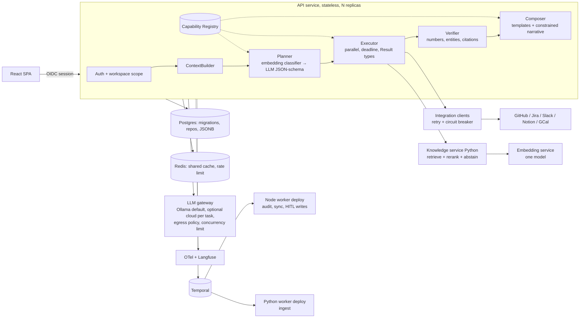

# EM TaskFlow AI — Product & Engineering Review for Production

> Companion to [`CODEBASE_DEEP_DIVE.md`](./CODEBASE_DEEP_DIVE.md). That document describes what the code *is*; this one recommends what it *should become*.
> All evidence cites `path:line` in the repo at commit `a7b76ae`. Recommendations are opinions. Facts are cited, and anything inferred is marked **(inferred)**.

---

## TL;DR

**As a product manager.** The product's real differentiator is the **proactive audit, the Action Hub, and trustworthy numbers pulled from the team's own tools**, not "10 AI agents". Today:

- Breadth (10 domains, 5 telemetry vendors, 4 LLM providers, 6 eval frameworks inside the admin UI) outruns trust.
- Answers can contain **invented people and invented metrics**.

Cut the surface to ~5 high-trust workflows, and make every number traceable to a source with a freshness timestamp.

**As an engineering manager.** The system is over-layered for what it does.

- Most EM answers come from **deterministic functions called directly** (`agentService.js:453-565`). The LangGraph supervisor, three routing layers and a monkey-patched LLM wrapper sit around that code but add little.
- **84 swallowed `.catch(() => …)` calls, 33 empty catch blocks** in `backend/src`, and **28 `except Exception: pass`** in the Python app hide real outages and real bugs. One example is shadow evaluation, which has never worked (`ChatApplicationService.js:210-216` vs `rest_router.py:24-29`).

The path to production:

1. **Stop the bleeding.** Add auth, rotate secrets, fix the correctness bugs.
2. **Make failure explicit.** Return typed results, surface degradation to the user, track metrics.
3. **Collapse the architecture** to *Plan → Execute (deterministic) → Verify → Compose*, with one capability registry.
4. **Harden RAG faithfulness**: abstain thresholds, chunk-level citations, citation verification, one embedding model.

---

## Decisions taken (2026-11-24)

| Decision | Choice | What it changes in this plan |
|---|---|---|
| Tenancy | **Single user** | Auth is one owner account (password + session cookie, or a static API token behind the reverse proxy). No `workspace_id` and no RBAC. The admin and chat surfaces share one identity. The scope of B.3.6 shrinks: horizontal scaling is a nice-to-have, while **reliability and restart safety** are the priorities. See §C.1 |
| LLM | **Local Ollama first; cloud is an opt-in option, off by default** | Every task runs on local Ollama (`hermes3:8b`) by default. One LLM gateway keeps a *pluggable* cloud provider that the owner can enable per task (for example only `compose`). Nothing leaves the machine unless explicitly enabled. Because the default model is small, the design leans on deterministic code, constrained JSON output and the Verifier rather than model strength. See §C.2 |
| Answer types | **Both document Q&A and tool-grounded answers are core**, including *hybrid* answers ("Is our PR review time within the SLA in our SOP?") | Remove the current **mutual exclusion** between RAG and tools (`agentService.js:347-349`, router rules 1/5/6 in `llmRouter.js:56-61`). Documents become a first-class capability that produces the same `Evidence` items as tools. See §C.3 |
| Language | **Keep JavaScript (ESM)** | No TypeScript migration. Types are JSDoc typedefs plus zod schemas validated at runtime (B.9, C.3). No build step is added |

Sections A–B below remain valid. Where they conflict with Part C, **Part C wins**.

---

# Part A — Product Manager lens

## A.1 Who it's for and the job to be done

- **Persona:** an engineering manager of one or more teams (5–20 engineers) who lives in GitHub, Jira, Slack, Notion and Calendar.
- **Jobs to be done, ranked by frequency × pain** **(inferred from the domain set and prompts)**:
  1. "What's at risk this week, and what do I need to act on?" (delivery risk, stalled PRs, blockers)
  2. "Prepare me for a 1:1 or a performance conversation." (people context plus SBI drafting)
  3. "Plan the next sprint realistically." (capacity, PTO, carry-over)
  4. "Report up." (status report, DORA trend, OKR pacing)
  5. "What does our policy, runbook or ADR say?" (document Q&A)

What wins is **trust and time saved**, not domain count. One wrong number about a person, in a performance conversation, is a churn event.

## A.2 KEEP — core value, invest here

| Keep | Why | Evidence |
|---|---|---|
| **Autonomous audit → Action Hub** | The only proactive feature, and the clearest differentiator over "chat with your tools" | `temporal/workflows.js:145-182`, `routes/actions.js` |
| **Delivery & DORA from GitHub/Jira** | High-frequency need, computable deterministically | `agent/doraAgent.js`, `agent/deliveryAgent.js`, `utils/doraMetrics.js` |
| **SBI feedback drafting** | High-value writing assistance; low data risk when grounded in real events | `agent/sbiAgent.js` |
| **Document Q&A (RAG)** | Policies, runbooks and ADRs are a real need | `rag/retriever.js`, Python `rag_processor/` |
| **Human-in-the-loop for anything posted externally** | The right trust model for Slack posts | `temporal/workflows.js:28-110` |
| **Local-first LLM (Ollama)** | Strong privacy story for people data | `config.js:52-70` |
| **Team roster / identity reconciliation** | Prerequisite for every people-related answer | `services/identityService.js`, `team_members` |

## A.3 REMOVE (or hide from end users)

| Remove | Why | Evidence |
|---|---|---|
| **Fabricated fallback data in production paths** | Destroys trust. When the roster is empty, the people tool analyses a fictional "Alex Williams". DORA fallback invents `review_wait_time = lead_time × 0.7`. Slack falls back to fake channel IDs | `peopleAgent.js:197-204,268`; `doraAgent.js:87-88`; `mcp/slack.js:427-449` |
| **Evaluation tooling inside the end-user Admin Portal** (Promptfoo cloud link, TruLens sweep, deep benchmark, trace replay, prompt matrix) | This is developer tooling, not product. It spawns shell processes from an unauthenticated API, and the TruLens script it references (`trulens_rag_triad.py`) isn't in the repo | `admin.js:120-683`, `admin.js:441,589` |
| **"10 agents" as a user-facing concept** | Users want outcomes. Ten overlapping domains confuse routing (rules 1–14 in the router prompt exist only to disambiguate them, `llmRouter.js:56-71`) | `llmRouter.js` system prompt |
| **The `DevSettingsModal` in the end-user chat** | Developer settings belong behind an admin role | `frontend/src/components/DevSettingsModal.jsx` |
| **Calendar *write* (`create_calendar_event`)** without HITL | An agent writing to calendars is a high-risk action that has no approval gate | `mcp/google.js:96` |
| **Legacy `/api/*` alias** once clients are migrated | Doubles the API surface | `routes/api.js` |

## A.4 MERGE — 10 domains become 5 capabilities

| New capability | Absorbs | User-facing promise |
|---|---|---|
| **Delivery Health** | dora, delivery | "What's at risk, and how are we trending?" |
| **People & Coaching** | people, sbi | "Prep my 1:1 / draft feedback" (always names the real engineer or asks) |
| **Sprint** | sprint, retro | "Plan the sprint / run the retro" |
| **Planning & Goals** | roadmap, okr | "Are we on track for the quarter?" |
| **Knowledge & Review** | rag, sop, critic | "What does our policy say? / Review my draft against it" |

The critic stops being a domain the user routes to. It becomes a **verification step** run on every answer (see B.6).

## A.5 ADD

| Add | Priority | Why |
|---|---|---|
| **Authentication and a workspace concept** (one EM login to start; `workspace_id` on every table) | P0 | People data plus write access to Slack. There is no auth today (`CODEBASE_DEEP_DIVE.md §7`) |
| **Freshness and provenance on every answer** ("GitHub, live, 2 min ago" / "Jira snapshot from Nov 12: Jira unreachable") | P0 | Turns silent fallbacks into a feature. `staleDataWarning` already exists but the user never sees it (`baseToolHarness.js:68,108`) |
| **"I don't know / I need X" answers** | P0 | Better than a confident wrong answer. Example: "Connect Jira to answer this", or "Which engineer?" |
| **Setup wizard and connection health page** | P1 | Today, misconfiguration shows up as vague answers |
| **Weekly EM brief** (scheduled digest built from the audit) | P1 | Extends the proactive differentiator. The Temporal schedule already exists (`temporal/client.js:410`) |
| **Clickable evidence**: every PR, ticket and doc chunk links to its source | P1 | Lets the user verify instead of trusting |
| **Action item lifecycle**: owner, due date, snooze, and dismiss-with-reason that feeds back into scoring | P1 | Without feedback, the audit repeats noise **(inferred)** |
| **Health score trend over time** | P2 | `em_audit_runs.health_score` is already stored per run |
| **Privacy controls**: retention for chat and people data, an "exclude person" option, PII redaction in traces sent to Langfuse | P1 | Performance-related data is sensitive |
| **Streaming responses** | P2 | Perceived latency with a local 8B model |

## A.6 ENHANCE

- **Answer format.** Replace the forced "Executive Summary / Key Document Analysis / Source Citations" headers on *every* RAG answer (`retriever.js:378-390`) with formats suited to the question: a short answer plus evidence by default.
- **Clarification UX.** When router confidence is low (`agentService.js:216`), offer two or three choices instead of free text.
- **Feedback.** Thumbs up/down exists (`routes/v1/chat.js:70`). Add a "wrong number / wrong person / outdated" reason, routed into the eval set.

## A.7 Product success metrics

| Metric | Target |
|---|---|
| Answers with ≥1 verifiable source link | ≥ 95% for tool and RAG answers |
| Fabricated-entity rate (person, ticket or number not in the evidence) | 0 in evals; < 0.5% in sampled production |
| Weekly active EMs opening the Action Hub | Leading indicator of the proactive value |
| Action items resolved vs dismissed | Measures audit precision |
| Latency on the Mac mini M4 (guardrail, not a goal) | Streamed first token visible quickly; p95 full answer < 60 s. Accuracy and faithfulness take priority over speed (§C.5) |

---

# Part B — Engineering Manager lens

## B.1 Guiding principles

1. **Deterministic code computes; the LLM plans and narrates.** Numbers, names and lists come from tools. The LLM never introduces one.
2. **No silent failure.** Every fallback is (a) typed, (b) logged with a reason, (c) counted in a metric and (d) shown to the user.
3. **One source of truth per concept.** One router, one capability registry, one embedding model, one settings store, one migration system.
4. **Contracts are tested.** The Node↔Python and API↔UI contracts get schema tests.
5. **Delete before adding.**

## B.2 REMOVE (dead code, duplicates, accidental complexity)

| Remove | Evidence | Saves |
|---|---|---|
| Unreferenced modules: `services/domainRegistry.js` (or revive it as the registry in B.3), `scripts/chromaClient.js`, `persistence/legacy/LegacyChatHistoryRepository.js`, `LegacyTaskCacheRepository.js`, `services/SessionCleanupWorker.js` (or wire it up) | No `src/` importers (grep) | Confusion |
| `cache/toolCache.js`, which only reports stats | `admin.js:28,1243` | A fake tier |
| `tracing.js` stub | `tracing.js:8` | — |
| **Unused gRPC path**: `proto/ai_service.proto`, `grpc_server/ai_service_grpc.py`, port 50051. Rename `backend/src/grpc/` → `pythonAiClient/` | Node is REST-only (`grpc/client.js:6-10`) | One protocol, one server |
| **Three overlapping routing layers** → one (B.5) | `llmRouter.js:78-380`, `agentService.js:607-668`, `graph.js:352-375` | ~600 LOC and the sync burden |
| **LangGraph supervisor and its monkey-patched LLM wrapper** for EM domains | Bypassed by `runRequiredDomainRecovery` (`agentService.js:395-403`); the wrapper patches `invoke`/`bindTools` (`graph.js:307-406`) | Upgrade fragility |
| **In-memory "fallback DB"** in `DatabaseService` | Unreachable when Postgres is down (`ensureInitialized` rethrows), and it masks errors in tests (`postgres.js:10-18`) | Hundreds of LOC |
| **Test fixtures in production code** (`isTestEnv` branches) | `sprintAgent.js:219-230`, plus 12 more `NODE_ENV==='test'`/`jasmine` checks in `agent/`, `temporal/`, `services/` | Correctness |
| `settings-backup.json` on disk with plaintext tokens, and the "self-heal" merge from it | `settingsService.js:96-199` | Security plus a hidden second source of truth |
| Unused dependencies: `cockatiel`, `bottleneck` (or *use* them, B.4), `llm-router`, `convict`, `openai@4`, `@langchain/mcp-adapters`, `@notionhq/notion-mcp-server`, `@cocal/google-calendar-mcp`, `promptfoo` in prod deps | grep shows no imports **(inferred)** | Install size, CVE surface |
| Telemetry sprawl: **Sentry + New Relic + Axiom + OTel + Langfuse** → **OTel (traces/metrics/logs) + Langfuse (LLM traces)** | `index.js:20-51`, `main.py:25-111`, `logger.js:4` | Cost, and the ESM hook conflict (`index.js:28-32`) |
| ~~Cloud LLM provider branches → one provider~~ **Superseded by §C.2**: Ollama is the default for every task; a cloud provider stays as an opt-in plug-in behind **one LLM gateway module**. Delete the ad-hoc provider branches in `llm/index.js:25-105` and the unused circuit-breaker config (`config.js:398-430`) | `config.js:52-70`, `llm/index.js:25-105` | One call site and one policy |
| Duplicate CI workflow and hard-coded "all passed" summaries | `.github/workflows/ci.yml` vs `backend-ci.yml` | Honest CI |
| Duplicate golden datasets (`backend/evaluation/` vs `evaluations/datasets/`, which differ: 3005 vs 783 lines) | `cmp` differs | One eval truth |
| Double reranking (Python reranks, then Node reranks again) | `rest_router.py:93`, `grpc/client.js:181` | Latency |
| Legacy tables `chat_history`, `user_preferences`, `task_cache`, and backend `pdf_chunks` | `postgres.js:175-234` | Schema noise |

## B.3 REFACTOR (to reduce complexity and maintenance cost)

### B.3.1 A single **Capability Registry** (biggest maintenance win)

Adding a domain today touches **7+ files** (`CODEBASE_DEEP_DIVE.md §8`). Replace that with one declarative entry per capability:

```js
// backend/src/capabilities/deliveryHealth.js
export default defineCapability({
  id: 'delivery_health',
  description: 'Delivery risk, PR/review bottlenecks, DORA trend',   // feeds router prompt
  examples: ['what is at risk this sprint', 'our lead time last 30d'],// feeds router few-shot + eval
  requires: ['github'],              // optional: ['jira']
  inputSchema: z.object({ repo: RepoRef.optional(), window: Window.default('30d'), engineer: PersonRef.optional() }),
  execute: async (input, ctx) => Result,   // deterministic; returns typed Result (B.4)
  render: (data) => Markdown,              // deterministic template for numbers/tables
  featureFlag: 'delivery_health',
});
```

The router prompt, keyword fallback, `VALID_DOMAINS`, `domainToolNames`, `recoveryTools`, feature flags, title labels and eval coverage report are all **generated from the registry**. Tool-name drift bugs disappear, for example `rag_search` vs `rag_db_query_retriever` (`graph.js:32` vs `agentService.js:26`) and `list_pull_requests` vs `get_pull_requests` (`agentService.js:49` vs `mcp/github.js:158`).

### B.3.2 Replace `agentService` with an explicit pipeline

Today there are 14 distinct `selectedPath` outcomes across nested branches (`agentService.js:102-451`). Replace them with four stages, each a pure-ish function with a typed output:

```
ContextBuilder → Planner → Executor → Verifier → Composer
```

| Stage | Responsibility | Replaces |
|---|---|---|
| **ContextBuilder** | History window, coreference, fact matrix, episodic recall → a single `ConversationContext` | `optimizeChatHistory`, `preRouterRewriter`, `episodicMemory`, `sessionFactMatrix` (four services, one concern) |
| **Planner** | `{intent: answer_direct|knowledge|capabilities|clarify, capabilities[], resolvedEntities, confidence}` using structured output | Fast-path + LLM router + two keyword fallbacks |
| **Executor** | Runs the planned capabilities in parallel under a deadline. Returns `Result[]` with provenance and freshness | `runRequiredDomainRecovery`, harness, supervisor |
| **Verifier** | Checks every number, person and ticket in the draft against the evidence; checks citations; computes groundedness | Nothing (new) |
| **Composer** | Deterministic sections (numbers/tables via `render`) plus an LLM narrative constrained to evidence IDs | `buildEmResponse` (`responseFormatter.js:8-120`) |

### B.3.3 Split the god files

| File | Lines | Split into |
|---|---|---|
| `db/postgres.js` | 2,446 | `db/pool.js` + `repositories/{session,thread,message,feedback,settings,team,audit,actionItem,snapshot}.js`; DDL moved to migrations |
| `routes/admin.js` | 1,307 | `admin/{settings,team,cache,audit,documents,system}.js`. Eval routes deleted (B.2) |
| `services/agentService.js` | 1,041 | The pipeline stages above |
| `temporal/activities.js` | 907 | `activities/{teamSync,audit,slack,cache}.js` |
| `frontend/src/components/AdminPage.jsx` | 3,479 | One component per tab (`overview`, `services`, `settings`, `storage`, `team`, `evaluation`) plus a router (`react-router`) instead of `window.location.pathname` checks (`App.jsx:22,46,323`) |

### B.3.4 Data layer

- Adopt **real migrations**: `node-pg-migrate` (or Knex migrations) for `taskflow_backend`, and Alembic or plain numbered SQL for `taskflow_ai`. Delete boot-time DDL and runtime DDL (`postgres.js:642`).
- Use **transactions** for multi-write use cases:
  - the user and assistant message pair (`ChatApplicationService.js:122-144`);
  - the audit run plus its action items (`activities.js:794-825`);
  - the `llm` and `mcp` settings pair (`settingsService.js:612-613`).
  - Batch `upsertActionItems` into a single multi-row `INSERT … ON CONFLICT`.
- Store JSON as **JSONB** consistently (`chat_messages.metadata`/`citations_json` are TEXT; `postgres.js:105-117`).
- **Python:** use a `psycopg_pool` connection pool instead of `psycopg.connect` on every call (`database.py:29-35`, used at 6 call sites), and batch embeddings.

### B.3.5 Config and secrets

- One config module. Replace `z.coerce.boolean()` with the existing `boolSchema` everywhere (`config.js:46-70,94-98`). Add `GITHUB_OWNER`/`GITHUB_REPO`/`FRONTEND_URL`/`REDIS_URL`/`TEMPORAL_HOST` to the schema, and ban direct `process.env` reads outside `config.js` with a lint rule (there are 246 reads in `src/` today).
- Runtime integration secrets: keep them in `app_settings`, **encrypted at rest** (AES-GCM with a key from env/KMS). Never write them to disk or to `process.env` (`settingsService.js:385-415`).

### B.3.6 Process topology for scale

- **Move the Temporal workers out of the HTTP processes**: the Node worker (`index.js:159`) and the Python worker (`main.py:116-119`) each become their own deployable. The API then becomes stateless and horizontally scalable.
- Move in-process state to Redis or the DB: the L1 cache (or drop it; see B.7), rate-limit buckets (`hardening.js:5`), admin job trackers (`admin.js:134-170`, which belong in Temporal anyway) and runtime metrics (move to OTel counters).
- Add an **LLM concurrency limiter** (a local GPU serves only a few requests at once) with a request deadline propagated through every hop. `bottleneck` is already a dependency.

## B.4 NO SILENT FAILURES — concrete design

**Today:**

- 84 swallowed catches and 33 empty catch blocks in `backend/src`; 28 `except …: pass` in the Python app.
- Errors are returned *as answer text* (`retriever.js:79,410`).
- Fallbacks are invisible to the user.
- A cross-service contract bug went unnoticed (shadow eval sends `user_query`; Python expects `query`).

**Target:**

1. **A typed `Result` for every tool, capability and external call:**

   ```js
   { status: 'ok' | 'degraded' | 'failed',
     data, error?: { code, message, retryable },
     provenance: [{ source:'github', mode:'live'|'snapshot', asOf, url }] }
   ```

   `degraded` means served from a snapshot. The Composer *must* render a degradation notice from `provenance`. The current `staleDataWarning` boolean is dropped.
2. **An error taxonomy and global error middleware.**
   - Codes: `INTEGRATION_UNAUTHORIZED`, `INTEGRATION_UNAVAILABLE`, `LLM_UNAVAILABLE`, `LLM_TIMEOUT`, `RETRIEVAL_EMPTY`, `VALIDATION`, `INTERNAL`.
   - One Express error handler maps codes to HTTP status and a safe message. Today status is inferred by matching strings like `message.includes('timed out')` (`routes/v1/chat.js:57-61`).
   - Never return `err.message` raw to clients.
3. **Lint rules:** ban empty `catch {}` and `.catch(() => {})` (ESLint `no-empty` plus a custom rule), and `except Exception: pass` (ruff `S110`, `BLE001`). Fire-and-forget calls go through one helper, `background(task, name)`, that logs and increments a `background_task_failures_total{name}` counter.
4. **A metric for every fallback:** `fallback_total{capability, from, to, reason}`, `tool_result_total{capability, status}`, `router_plan_total{intent, source=llm|rule}`. Alert when `degraded` exceeds X% for 15 minutes.
5. **Fail fast where it matters.**
   - In `NODE_ENV=production`, refuse to start without the DB, and without auth configured.
   - `/health/ready` reports per-dependency status instead of "up".
   - Startup currently warns and continues on every failure (`index.js:100-163`).
6. **Contract tests.**
   - Generate the Python request/response schemas (pydantic → JSON Schema). Validate the Node client against them in CI.
   - Validate every Python response on the Node side with zod, so a 422 or schema drift fails loudly.
7. **Cap fire-and-forget work** with a bounded queue. Unbounded `setImmediate` fetches today (`ChatApplicationService.js:204`) pile up when Python is slow.

## B.5 Correctness fixes (do first; each is small)

| # | Fix | Evidence |
|---|---|---|
| 1 | Shadow eval payload field names; add a contract test | `ChatApplicationService.js:210-216` vs `rest_router.py:24-29` |
| 2 | `z.coerce.boolean` → `boolSchema` (`"false"` currently means true) | `config.js:46-70,94-98` |
| 3 | Add `GITHUB_OWNER`/`GITHUB_USERNAME` to the schema (stripped today) | `config.js:450` |
| 4 | Tool-name mismatches: `rag_search`/`rag_db_query_retriever`, `get_pull_requests`/`list_pull_requests` (solved structurally by the registry) | `graph.js:32`, `agentService.js:26,49` |
| 5 | People capability must receive a **resolved engineer** or ask "which engineer?". Never pass the whole query or default to a fictional person | `agentService.js:465`, `peopleAgent.js:197-204,268` |
| 6 | Word-boundary keyword matching (`\bpr\b`, not `includes("pr")`) | `agentService.js:620-623`, `graph.js:368` |
| 7 | Thread ownership check in `ensureThread` and `GET /threads/:id/messages`; scope `GET /sessions` | `postgres.js:799-829`, `sessions.js:29,178` |
| 8 | Remove the duplicate `CREATE DATABASE taskflow_backend` from the init SQL | `init-databases.sql:2` vs `docker-compose.yml:114` |
| 9 | Wire up (or delete) `SessionCleanupWorker` | No importer |
| 10 | Clear the timer in `safeExecuteMCPTool`'s `Promise.race` | `baseAgent.js:59-62` |
| 11 | Add a `SIGTERM` handler: drain HTTP, stop the Temporal worker, close the pool | `index.js:201-206` |
| 12 | nyc `include: dist/src/**` → `src/**`, so coverage measures something | `backend/package.json` nyc block |

## B.6 FAITHFULNESS — making answers provably grounded

The core rule: **an answer may only contain facts that appear in the evidence.** Enforce it in code, not in prompt text.

1. **Numbers and lists are rendered, not generated.** Each capability's `render(data)` produces the metrics and tables with a deterministic template. The LLM writes only the narrative ("why it matters / what to do"). It receives evidence as `[E1] lead_time_hours=31.2 (github live, 2026-11-18)`, and may reference only `E#` IDs.
2. **A Verifier step, run after composition and before returning:**
   - *Numeric claims:* extract numbers from the narrative; each must match an evidence value (with tolerance and unit). Otherwise strip the sentence or regenerate once.
   - *Entity claims:* names, ticket keys and PR numbers must exist in the evidence or the team roster.
   - *Citation claims:* every `[c#]`/`[E#]` must resolve to a passed chunk or evidence item.
   - Output a `groundedness` score in `meta`. Below the threshold, return the deterministic sections only, plus "I couldn't verify a summary."
   - This is where today's `critic` agent belongs, as an automatic gate rather than a routed domain.
3. **Remove fabricated derivations** such as `review_wait_time_hours = lead_time × 0.7` and `ci_build_time_hours = 0.25` (`doraAgent.js:87-88`). Unknown values are rendered as "not available (connect X)".
4. **RAG prompt contract** (replacing `retriever.js:378-390`):
   - "Answer only from the context."
   - "If the context doesn't contain the answer, reply `INSUFFICIENT_CONTEXT`."
   - Cite chunk IDs `[c3]` after each claim.
   - No forced section headers.
5. **Abstain on weak retrieval.** If the top rerank score is below τ (calibrated on the eval set), return "not found in your documents" *before* calling the LLM. Today any non-empty result goes to the LLM.
6. **Fix shadow eval** and make it actionable. Sample 5% of traffic, compute faithfulness and answer relevance, store the scores on the message, and send low-scoring traces to a review queue. It has never run (B.5 #1).
7. **Eval gates in CI**, split by cost:
   - *Every PR (no LLM):* router/planner on recorded fixtures, capability math, verifier unit tests, contract tests.
   - *Nightly (with LLM):* faithfulness ≥ 0.9, fabricated-entity rate = 0, citation precision ≥ 0.95, routing accuracy ≥ 0.9.
   - Pulling `hermes3:8b` on every PR, as both workflows do today, is slow and costly.

## B.7 RAG improvements

| Area | Today | Change |
|---|---|---|
| Embedding models | Two: Ollama `nomic-embed-text` (768d) for retrieval (`database.py:86-112`), and in-process `multilingual-e5-large` downloaded from the HF hub for the semantic cache (`bgeEmbeddingsClient.js:4-14`) | **One model, one embedding service.** The query is embedded once and reused for cache lookup and retrieval |
| Semantic answer cache | Redis `KEYS` plus a full scan with JS cosine (`semanticCache.js:225-243`); scoped by domain, not user or corpus version; answers can outlive document changes | Short term: **cache retrieval results, not answers**, keyed by `(query_embedding, corpus_version, filters)`. If answer caching stays, use pgvector or RediSearch KNN, scope by workspace, and invalidate on ingest |
| L1 exact cache | Per-process Map (`l1ExactCache.js`) | Remove, or move to Redis with the same key scheme |
| Rerank | Twice: Python inside search, then Node again | Once, in Python. Return scores. Apply the abstain threshold |
| "MMR" | 120-char prefix dedup (`rest_router.py:95-102`) | Real MMR on embeddings, or call it dedup |
| Chunking | Token windows with prev/next parent (`chunker.py:9-70`) | Structure-aware: heading path, tables kept intact, **page numbers** stored for citations |
| Document lifecycle | Re-upload appends; delete by filename (`database.py:374`) | `documents` table with `content_hash`, `version` and `status`. Re-ingest replaces atomically. Bump `corpus_version` for cache invalidation |
| Metadata filters | Filename only | Doc type (policy, ADR, runbook), tags, date, owner. The planner can set filters ("in the ADRs…") |
| Ingest via Temporal | Full text and chunks pass through workflow payloads (`workflow.py:46-75`) | Pass object keys/IDs only, and stream chunks from storage. Avoids payload limits **(inferred risk)** |
| Retrieval eval | Golden Q&A only | Add **retrieval metrics**: recall@k, MRR, nDCG on labelled query→chunk pairs. Tune `k`, the RRF constant, HNSW `ef_search` and τ from data |
| Agentic mode | Query rewrite + HyDE + LLM compression = 3+ extra LLM calls (`retriever.js:90-225`) | Gate it behind measured gains. On an 8B local model, HyDE often hurts precision **(inferred)**. Keep it only if recall@k improves on the eval set |
| Sources beyond uploads | PDFs/DOCX only | Phase 2: incremental sync of Notion and Confluence pages into the same index, with per-source ACL tags |

## B.8 Multi-agent improvements

**Reality check.** Each "agent" is bound to exactly one deterministic tool (`baseAgent.js:25-45`, "1-tool bounding"). Most EM queries skip the supervisor and call those tools directly (`agentService.js:395-403`). The supervisor needs an LLM wrapper that *overrides* the model's handoff decisions with keyword rules (`graph.js:338-391`). For an 8B local model, a planner plus deterministic executors is more reliable, cheaper and easier to test than a supervisor with sub-agents.

Recommendations:

1. **Replace the supervisor with Planner → parallel Executors → Verifier → Composer** (B.3.2). Keep LangGraph only if a genuinely multi-step workflow appears. Then use an explicit `StateGraph` with typed nodes, not `createSupervisor` with patched handoffs.
2. **Planner with structured output.** Use Ollama's JSON-schema `format` (or grammar-constrained decoding) so the plan is always valid JSON. That deletes the `<think>`-stripping, regex extraction and truncated-JSON repair (`llmRouter.js:405-466`).
   - Use a two-stage router: (a) an embedding-similarity classifier against each capability's `examples` (fast, cheap, deterministic); (b) the LLM only when the top-2 classes are close.
   - Calibrate `confidence` on the eval set instead of trusting the LLM's self-reported number (`agentService.js:216`).
3. **Entity resolution before execution.** The planner extracts `engineer`, `repo`, `sprint` and `window`. `identityService` resolves them against the roster. If an entity is ambiguous or missing, ask instead of guessing (fixes B.5 #5).
4. **Execution budget.** Give each capability a timeout from the request deadline, run them concurrently, and return partial results with per-capability status. Today one slow tool holds up `Promise.all` (`agentService.js:526-536`), and failures become `status:'FAILED'` that the user never sees.
5. **Tool-level retry and circuit breaking** in one place (`BaseIntegrationClient`), using `cockatiel`, which is already a dependency: retry idempotent GETs, break on repeated 5xx or 429, and respect `Retry-After`.
6. **Writes always go through HITL.** Any capability that writes (Slack post, calendar event, Jira comment) produces a *proposal* that the Temporal HITL workflow executes after approval (`workflows.js:28-110`). This generalises the existing Slack flow.
7. **Memory consolidation.** Four context mechanisms (history optimizer, pre-router rewriter, episodic memory, fact matrix) become one `ContextBuilder`, with one token budget and one test suite.
8. **Observability per stage.** One Langfuse trace per request with spans for plan, each capability, verify and compose, tagged with `plan.source`, `result.status` and `groundedness`. Strip PII from people data before export.

## B.9 Testing and quality bar

- **Lint/format/types (staying on JavaScript):** ESLint plus Prettier. Shared shapes (`Result`, `Evidence`, capability definitions) are **JSDoc `@typedef`s backed by zod schemas**, so they are checked at runtime at every boundary (tool output, Python responses, API bodies). Editor-only checking with `// @ts-check` is optional and needs no build step. For Python, ruff plus mypy. None exist today.
- **CI:** one workflow with **Postgres (pgvector) and Redis service containers**. Real-DB repository tests replace the in-memory seeding (`test/setup.js:17-27`). Counts are generated from the run, not echoed.
- **Frontend:** add Vitest plus React Testing Library. The existing `*.test.js` files currently have no runner.
- **Test pyramid targets:** capability math and verifier ≥ 90% line coverage; planner on recorded fixtures; three Playwright e2e flows (chat with tool answer, document Q&A, Action Hub resolve).

## B.10 Target architecture



## B.11 Phased roadmap

| Phase | Scope | Exit criteria |
|---|---|---|
| **0 — Stop the bleeding** (≈1 week) | Rotate and remove the compose secrets; close the debug port; add single-owner auth on all routes (§C.1); fix the provider-flag egress bug (§C.2); correctness fixes B.5 #1–12; remove fabricated fallbacks (A.3 row 1) | No unauthenticated route; zero fictional entities in evals; shadow eval returns 200 |
| **1 — Make failure explicit** (2–3 weeks) | `Result` type; error middleware and taxonomy; lint bans on empty catches; fallback metrics and alerts; provenance/freshness rendered in the UI; readiness endpoint; contract tests; one CI with real Postgres and Redis | Swallowed catches 84 → 0 (or annotated with a counter); every degraded answer shows its source and age |
| **2 — Collapse the architecture** (4–6 weeks) | Capability registry; 10 → 5 capabilities; pipeline replaces `agentService` and the supervisor; migrations; split god files; workers as separate deployables; telemetry → OTel + Langfuse; delete the B.2 list | Adding a capability = 1 file + tests; `agentService.js`, `graph.js` and `llmRouter.js` deleted; API horizontally scalable |
| **3 — Faithful RAG and agents** (4 weeks, overlaps Phase 2) | Verifier; templated numbers; RAG abstain threshold; chunk citations with page numbers; one embedding model; document versioning; retrieval eval; structured-output planner; entity resolution; HITL for all writes | Nightly: faithfulness ≥ 0.9, citation precision ≥ 0.95, routing ≥ 0.9, fabricated entities = 0 |
| **4 — Product expansion** | Weekly EM brief; action item lifecycle and feedback; health trend; Notion/Confluence knowledge sync; streaming; multi-workspace | Product metrics in A.7 tracked on a dashboard |

## B.12 Expected impact (estimates)

| Dimension | Change |
|---|---|
| Backend LOC | −25–35% from deletions in B.2 and the pipeline collapse **(inferred)** |
| Files touched to add a capability | 7+ → 1 |
| Execution paths to reason about | 14 `selectedPath` values → 4 intents |
| LLM calls per tool answer | Router + supervisor + formatter (up to ~3–5) → planner (often 0 via the classifier) + 1 narrative **(inferred)** |
| Telemetry vendors | 5 → 2 |
| Silent failure sites | 84 + 33 + 28 → 0 unannotated |
| Unauthenticated destructive endpoints | all → 0 |

---

---

# Part C — Design under the chosen decisions

## C.1 Single user

**Auth (Phase 0).**
- One owner account, created on first run. Store an argon2/bcrypt password hash in `app_settings` (or an env-provided hash).
- Login sets an `HttpOnly; Secure; SameSite=Strict` session cookie. An `Authorization: Bearer <token>` header is accepted for scripts and the evaluation CLI.
- One `requireOwner` middleware is mounted in `routes/v1/index.js` before every router except `/health` and the OAuth callbacks.
- Lock CORS to `FRONTEND_URL`, and add a CSRF token on state-changing routes. Cookie auth still needs these, even for one user.

**What can be dropped because there is one user:**
- The anonymous-session machinery. Session IDs from query, header or cookie (`SessionApplicationService.js:12-17`) collapse to "the owner". Keep `chat_threads` but drop `sessions` as a security boundary (it can remain a UI grouping).
- The IDOR fixes in B.5 #7 become low priority once everything sits behind owner auth. Keep the ownership checks anyway; they are cheap.
- Multi-replica concerns: in-process caches and rate limits are acceptable. **But still run the Temporal workers as separate processes** (B.3.6). The reason is restart isolation: a crashed ingest must not kill chat. Throughput is not the reason.

**Still required for a single user:** secret rotation, encrypted integration tokens, the debug port closed, backups of `taskflow_backend` and `taskflow_ai` (`docs/operations/backup-recovery.md`), and retention settings for chat and people data.

## C.2 Local Ollama first, cloud as an opt-in option

**Default posture.** Every model call goes to local Ollama (`hermes3:8b` for chat, `nomic-embed-text` for embeddings). A cloud provider is an **optional plug-in that is off by default**. Data leaves the machine only when the owner turns cloud on for a specific task in settings.

**One LLM gateway** (`backend/src/llm/gateway.js`) is the only place that calls a model:

```js
llm.call({
  task: 'plan' | 'compose' | 'verify' | 'rag_answer' | 'summarize' | 'embed',
  messages, schema?,            // zod → JSON schema for constrained output
  sensitivity: 'public' | 'internal' | 'people',  // only matters if cloud is enabled
  budget: { maxTokens, deadlineMs },
})
```

- **Routing table in config.** Defaults: every task → `ollama`. Optional overrides, for example `compose: cloud` with fallback `ollama`. With cloud off, the gateway never builds a cloud client. Today all providers are constructed from config branches in `llm/index.js:25-105`; those branches move into the gateway.
- **Make the small local model reliable (the main work while Ollama is primary):**
  - **Constrained JSON output** via Ollama's `format` parameter (JSON schema) for the planner and verifier. That replaces the regex extraction, `<think>` stripping and truncated-JSON repair in `llmRouter.js:405-466`.
  - **Do less with the LLM.** Use the embedding-similarity classifier for routing (B.8 #2), so most queries need **no** planning call. Numbers and tables come from templates (B.6 #1); the model only writes a short narrative.
  - **Small, focused prompts.** The 14-rule router prompt (`llmRouter.js:40-74`) is replaced by capability descriptions generated from the registry. Keep context under the model's window: compact evidence IDs instead of raw JSON dumps.
  - **The Verifier is mandatory, not optional.** An 8B model will drift from "cite evidence IDs only". The deterministic number, entity and citation checks (B.6 #2) are the guarantee. If verification fails, return the deterministic sections only.
  - **One concurrency limiter for Ollama** (`bottleneck` is already a dependency). A local GPU handles only a few generations at once, so queue requests rather than letting them time out. Give background work (audit, shadow eval) lower priority than chat.
  - **Warm-up and health.** Pre-load the model at startup and report "model loaded / not loaded" on `/health/ready`, instead of failing on the first query.
  - **Fewer LLM calls per answer.** Agentic RAG (query rewrite + HyDE + compression, `retriever.js:90-225`) is 3+ extra local generations. Keep it off unless the retrieval eval shows a gain.
- **If cloud is enabled later:**
  - An egress policy decides which `sensitivity` levels may be sent (recommended default: `people` never leaves; or names are pseudonymised and re-hydrated locally).
  - Every cloud call is counted (`llm_egress_total{task,provider,sensitivity}`), secrets are stripped from prompts, and a daily spend cap applies.
  - Nightly evals run per enabled model, so turning cloud on for a task is a measured decision.
- **Embeddings stay local.** Use `nomic-embed-text` for both retrieval and the cache (B.7), and remove the in-process `multilingual-e5-large` used by the semantic cache (`bgeEmbeddingsClient.js:4`). It downloads from the Hugging Face hub on first use and is a second model to run.
- **Evals.** Nightly gates run on `hermes3:8b` (the production default). PR CI uses recorded fixtures, so it doesn't need to pull the 8B model on every PR.
- **Project rules.** The "Zero Cloud LLM Requirement" in `CLAUDE.md`, `AGENTS.md` and `GEMINI.md` should become "Local Ollama by default; cloud only through the gateway when explicitly enabled."
- **Config bug is still Phase 0.** `LLM_OPENAI_ENABLED=false` currently *enables* OpenAI (`config.js:56`, `z.coerce.boolean`). With a local-first promise, this flag silently breaks the promise. It must be fixed before anything else in the gateway work.

## C.3 Document Q&A **and** tool-grounded answers, including hybrids

**Problem today.** The two kinds of answer are mutually exclusive:

- `agentService.js:347-349` disables RAG whenever any non-`rag`/`sop` domain is routed ("Strict Domain Exclusivity").
- The router prompt tells the model never to combine them (rules 1, 5 and 6, `llmRouter.js:56-61`).
- RAG answers and tool answers come back in different shapes: `sources[]` of chunks vs free-text `data.summary`.

So a question like "Are we meeting the review SLA in our engineering SOP?" cannot be answered correctly. It needs the SOP document *and* the PR metrics.

**Design: one evidence model, two kinds of capability.**

```js
// backend/src/core/types.js — JSDoc typedefs, plain JavaScript
/**
 * @typedef {Object} Evidence
 * @property {string} id            e.g. 'E1' (tool evidence) or 'D3' (document chunk)
 * @property {'metric'|'record'|'doc_chunk'} kind
 * @property {string} source        'github' | 'jira' | 'slack' | 'notion' | 'calendar' | 'document'
 * @property {string} title
 * @property {string} [url]         PR/ticket link or doc#page
 * @property {number} [value]       for metrics
 * @property {string} [unit]
 * @property {string} [text]        for records and chunks
 * @property {string} asOf          ISO timestamp
 * @property {'live'|'snapshot'|'indexed'} mode
 * @property {number} [score]       rerank score for doc chunks
 */
export const EvidenceSchema = z.object({ /* same shape, validated at runtime */ });
```

- **The knowledge capability** (`knowledge.search`) is registered like any tool capability (B.3.1). It returns `doc_chunk` evidence with page-level citations and rerank scores. It abstains below threshold τ by returning `status:'ok', data: []` plus a reason, never a fabricated answer.
- **Planner output** lists capabilities *including* knowledge, with an explicit `answer_mode`:
  - `documents` → knowledge only;
  - `tools` → tool capabilities only;
  - `hybrid` → both, run **in parallel** under the same deadline;
  - `direct` → no evidence needed (general or conceptual).
- **Hybrid composition.**
  - Policy and SOP chunks supply the *rule* (`D2: "PRs must be reviewed within 24h"`).
  - Tool metrics supply the *fact* (`E1: median review wait = 31.2h`).
  - The Composer produces a **comparison block** deterministically where possible: rule vs actual, and pass or fail. The LLM explains, citing both IDs.
  - The Verifier checks that each claim's number traces to `E*` and each policy statement to `D*`.
- **The SOP and critic capabilities become hybrid by construction.** SOP compliance = knowledge (the rule) + tools (the behaviour). Critic = the Verifier applied to user-supplied drafts against knowledge and tool evidence.
- **The audit uses hybrid too.** The Temporal audit can check findings against uploaded SOPs, for example deducting the health score only when a documented SLA is violated, with the SOP chunk cited on the action item.
- **UI.** One evidence panel per answer shows tool evidence (with live/snapshot badge and timestamp) and document evidence (filename, page, snippet), each clickable.

**Code changes (replacing the relevant parts of B.3.2 and B.8):**
1. Delete the exclusivity rule (`agentService.js:347-349`) and router rules 1/5/6's "do NOT combine" clauses. These are moot once the planner and registry replace the router.
2. Wrap `rag/retriever.js` as a capability whose `execute` returns `Evidence[]`, not a finished answer. Move answer generation into the shared Composer, so document and hybrid answers use one prompt contract and one verifier.
3. One citation format for both: `[E#]`/`[D#]`. The current `[Document: filename.pdf]` free-text convention (`retriever.js:389`) is removed.
4. Evals gain a **hybrid slice**: golden questions that require both a document rule and a tool metric, scored on citation precision for both `E*` and `D*` and on correct pass/fail.

## C.4 Revised Phase 0–1 checklist (single user, local-first LLM, hybrid answers)

| # | Item | Phase |
|---|---|---|
| 1 | Owner login + `requireOwner` on all routes; CORS locked; CSRF token | 0 |
| 2 | Rotate the compose-embedded keys; close port 9229 | 0 |
| 3 | Fix the `z.coerce.boolean` bug so disabled cloud providers stay disabled | 0 |
| 4 | Remove fabricated fallbacks (Alex Williams, ×0.7 review wait, fake Slack channels) | 0 |
| 5 | Shadow-eval contract fix + contract tests | 0 |
| 6 | LLM gateway: Ollama default for every task, constrained JSON output, concurrency limiter, warm-up; cloud as an off-by-default plug-in | 1 |
| 7 | `Result` + `Evidence` types; provenance rendered in the UI | 1 |
| 8 | Knowledge capability returns `Evidence[]`; remove RAG/tool exclusivity; hybrid eval slice | 1–2 |
| 9 | One embedding model (nomic); remove the e5 semantic-cache embedder | 1 |
| 10 | Update `CLAUDE.md`/`AGENTS.md`/`GEMINI.md` architecture rules to match these decisions | 1 |

## C.5 Local model choice for the target hardware (Mac mini M4, 16 GB unified memory, 256 GB disk)

**Selection priority (owner decision, 2026-11-24): quality over speed.** Rank models in this order, and treat latency only as a guardrail:

1. **Tool calling.** Picks the right tool, fills arguments correctly, makes *no* call when none is needed, and never invents tool names or arguments.
2. **Faithfulness.** Copies numbers, names and IDs from tool output exactly, and adds nothing that isn't in the evidence.
3. **Abstention and correction.** Says "insufficient data" when a tool fails or returns nothing, instead of filling gaps. Fixes its own call when given a validation error.
4. **Structured output.** Valid JSON against the schema on the first try.
5. **Latency (guardrail only).** p95 full answer under ~60 s on the M4. A slower, more accurate model is preferred.

**The model is not the only lever.** On an 8B–14B local model, tool-calling reliability comes as much from the harness as from the weights. These apply to whichever model wins:
- **Few tools per call.** The planner sees only the capabilities that the classifier shortlisted (3–5), not every tool. Accuracy drops as the tool list grows.
- **Typed arguments with enums.** Use enums for `window`, `mode` and `source`, and resolved IDs for engineers and repos (B.8 #3). The model chooses from a list instead of writing free text.
- **Constrained decoding.** Use Ollama `format` (JSON schema) for plans, with zod validation on every call.
- **One repair turn.** On a schema or validation error, send the error back once ("argument `window` must be one of 7d/30d/90d"), then fail loudly. No silent fallback to keyword routing.
- **Deterministic numbers and the Verifier** (B.6) protect faithfulness whichever model is used.
- **Temperature 0** for `plan`/`verify`, and low for `compose`.

**Memory budget (inferred; verify with Activity Monitor).**

| Consumer | Approx. memory |
|---|---|
| macOS + apps | 3–4 GB |
| Docker Desktop VM, full stack (Postgres, Redis, Temporal + UI, Langfuse + analytics DB, Adminer, Python service, backend with the in-process e5-large embedder) | 4–6 GB |
| Docker Desktop VM, **lean** stack (observability profile off, e5 embedder removed, VM memory capped at ~3 GB) | ~3 GB |
| **Left for Ollama** (weights + KV cache), full stack / lean stack | **≈ 6–8 GB / ≈ 9–10 GB** |

Because quality comes first, **run the lean stack day to day** and spend the freed memory on a bigger model or a higher-precision quantization.

**Quantization matters for tool calling.** Lower-bit quantizations (Q4) degrade argument precision and JSON adherence more than general chat quality **(inferred; commonly reported, verify on the eval)**. Approximate sizes for an 8B model: Q4_K_M ~5 GB, Q5_K_M ~5.8 GB, Q6_K ~6.6 GB, Q8_0 ~8.7 GB.

**Candidates, ranked for this priority order** (to be confirmed by the eval below):

| Rank | Model / quant | Approx. weights | Fits | Why it's a candidate |
|---|---|---|---|---|
| 1 | `qwen3:8b` at **Q6_K or Q8_0** | 6.6–8.7 GB | Q6_K: yes; Q8_0: lean stack only | Tool calling built into the chat template; most-recommended 8B for tool use. Higher precision to protect argument accuracy |
| 2 | `qwen3:14b` at Q4_K_M | ~9 GB | Lean stack only, small context (4k–8k); tight, watch for swap | More parameters usually help tool selection and abstention. Only adopt if it clearly beats #1 without swapping |
| 3 | `qwen3:8b` at Q4_K_M | ~5 GB | Yes, full stack | Fallback when memory is short |
| — | `hermes3:8b` (current) | ~5 GB | Yes | Baseline for comparison |
| — | `llama3.1:8b` at Q6_K/Q8_0 | 6.6–8.7 GB | Yes / lean | Alternative tool-calling model from a different family |
| — | Gemma 4 small variant | — | Check | Reportedly native function calling. **Unverified**; confirm tool support with `ollama show <model>` before testing |

Not viable on 16 GB with this stack: `gpt-oss:20b` (~14 GB) and 20B+ models.

**Qwen3 "thinking" mode.** Since latency is secondary, **test thinking ON for `plan`** (it often improves tool selection and argument filling) and keep it OFF for `verify` (a deterministic, JSON-only check). Decide from the eval, not by default. The gateway should set thinking per task. The current code only strips `<think>` blocks (`llmRouter.js:406`).

**Tool-calling eval: how to choose (replaces the latency-led gate).**

Building blocks already in the repo:
- `backend/evaluation/golden-dataset.json` has **138 cases with `expected_tool_calls`**.
- `backend/evaluation/evaluators/multi-agent-eval.js` scores domain routing and tool abstention.
- The EM-τ-Bench runner **does not exercise a model**. `_simulate_agent_execution` returns scripted actions chosen by keyword matching (`services/python-ai-service/evaluation/em_tau_bench/reliability_runner.py:42-62`). As written, it cannot compare models. Wire it to the real planner/executor before using its pass^k metric.

Add a model-comparison harness that runs every candidate through the **real planner and executor** with recorded tool responses (so tool results are identical across models):

| Metric | Definition | Gate |
|---|---|---|
| Tool selection accuracy | Correct set of tools called | ≥ 95% |
| Argument accuracy | Exact match on typed args (repo, engineer ID, window, mode) | ≥ 95% |
| No-call precision | Correctly makes no tool call on direct, conceptual or follow-up questions | ≥ 95% |
| Hallucinated tool or argument rate | Tool name, or enum value, that doesn't exist | 0% |
| First-try schema validity | Plan JSON valid without repair | ≥ 98% |
| Repair success | Fixes the call after one validation-error turn | ≥ 90% |
| Faithfulness | Every number, name and ID in the answer appears in tool output (Verifier check) | ≥ 98% |
| Fabrication under failure | Tool returns error or empty → answer says so, invents nothing (inject failures in 20% of cases) | 0 fabrications |
| Hybrid citation precision | `[E#]`/`[D#]` citations resolve and support the claim (C.3) | ≥ 95% |
| **pass^k consistency** | Same case run k = 5 times, all correct (stability matters for a tool agent) | Report; prefer higher |
| Latency | p95 full answer | Guardrail only: < 60 s |

**Decision rule.** Pick the model with the best weighted score (tool selection and arguments 40%, faithfulness and fabrication-under-failure 35%, abstention 15%, schema validity 10%) that has **zero** hallucinated tools and **zero** fabrications under failure. Then confirm it runs without swap on the lean stack (`vm_stat` and Activity Monitor memory pressure stays green). Re-run the comparison whenever a new local model is released. With the gateway, switching is one config value.

**Ollama settings for 16 GB** (Ollama runs natively on macOS, not in Docker, so it gets Metal acceleration; compose already points at `host.docker.internal:11434`):
- `OLLAMA_NUM_PARALLEL=1` and `OLLAMA_MAX_LOADED_MODELS=2` (chat model + embedder).
- `OLLAMA_FLASH_ATTENTION=1` and `OLLAMA_KV_CACHE_TYPE=q8_0`, which roughly halves KV-cache memory and leaves room for a higher-precision model.
- `num_ctx` 8192 (4096 if running `qwen3:14b`). The ContextBuilder budget (B.3.2) keeps prompts within it.
- `OLLAMA_KEEP_ALIVE=30m` so the model isn't reloaded for every chat.

**Free memory and disk for the model:**
- Remove the in-process `multilingual-e5-large` embedder (C.2), saving roughly 0.5–1 GB in the backend **(inferred)**.
- Put `adminer`, `temporal-ui`, `langfuse` and `analytics-db` behind an optional compose profile (`docker compose --profile observability up`), and cap Docker Desktop's VM memory.
- Disk: keep at most two or three chat models pulled (5–9 GB each), and prune Docker images and build cache periodically (`docker system df`).

**Code changes needed to switch models cleanly:**
- `hermes3:8b` is hard-coded in about 20 places: `llm/index.js:112,124,160`, `services/settingsService.js:262,431,526`, `routes/admin.js:102,186,407`, `temporal/client.js:139,163,237`, `scripts/promptfooServer.js` and Python eval defaults. Replace them with one config value, with separate values per task (`plan`, `compose`, `verify`).
- The model saved in `app_settings` overrides `LLM_DEFAULT_MODEL` after the first run (`settingsService.js:260,431`). Change it in Admin → Settings (or the DB), not only in `.env`.
- Eval endpoints default to `hermes3:8b`, so they must take the candidate model explicitly.

## Remaining open questions

1. **If cloud is ever enabled:** which provider, and may people data be sent (never, pseudonymised, or raw)?
